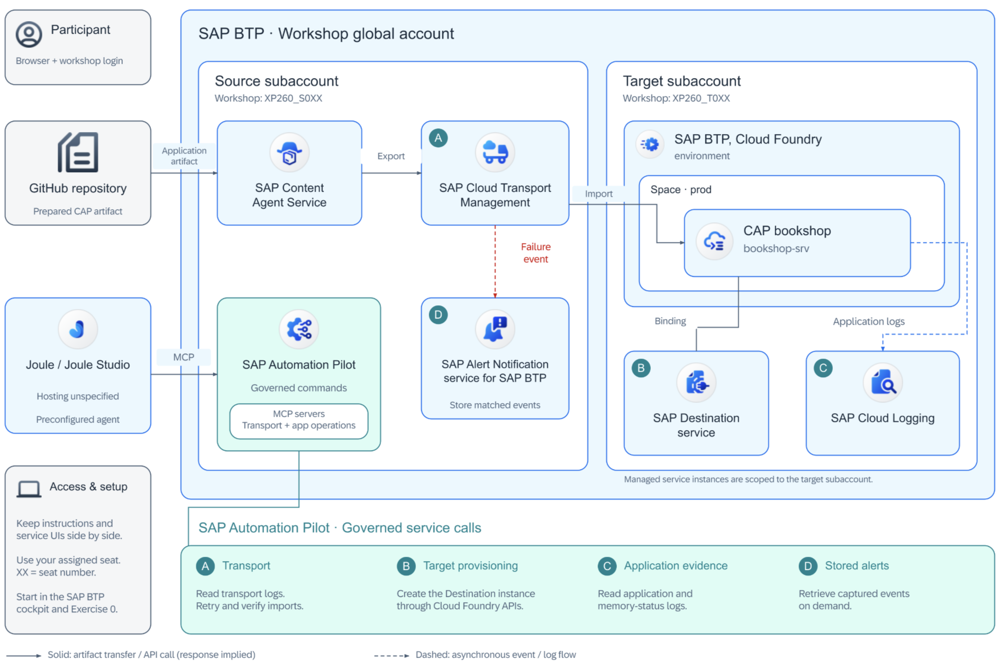
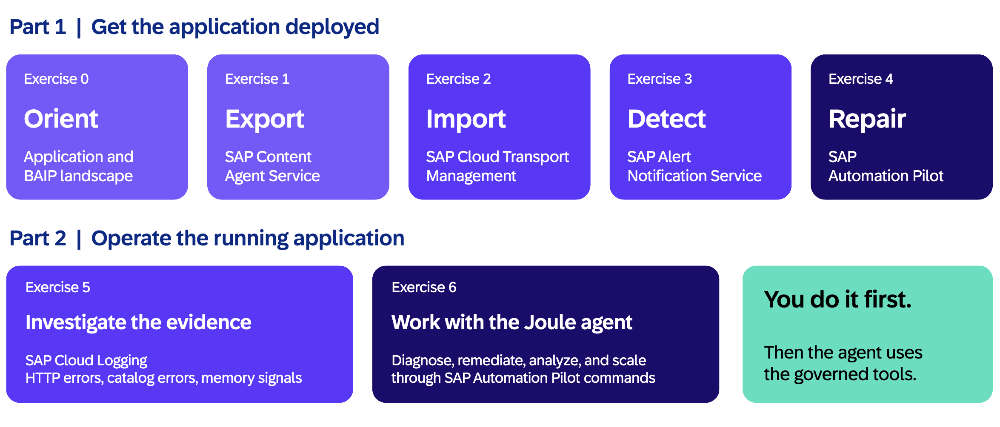

# XP260 - Deploy, review, break, fix: Govern cloud transports with agility and AI

## Description

This repository contains the material for the SAP TechEd 2026 session XP260 - Deploy, review, break, fix: Govern cloud transports with agility and AI.

## Overview

Learn how to govern the full lifecycle of a cloud application on SAP BTP — from deployment and transport, through automated failure detection and remediation, to AI-assisted Day 2 operations.

Get hands-on with SAP Content Agent Service, SAP Cloud Transport Management, SAP Alert Notification Service, SAP Automation Pilot, SAP Cloud Logging, and Joule to build an end-to-end delivery and operations pipeline. This session shows how deterministic automation and AI agents work together: the agent reasons about the situation, then calls the governed automation to take action. Walk away with a working blueprint for governed cloud delivery combined with event-driven automation and AI-assisted operations.

This repository accompanies the SAP TechEd 2026 session XP260 and provides the guided exercises for participants.

Find below a scenario description and links to all exercise material.

## Introduction and Scenario Overview

Workshop overview is shared below covering main interactions: export and transport the app, capture failure events and pperate it through governed commands.

### Scenario Solution Overview 

See the architecture diagram to uderstad all interactionsn and how compoents fit together in an end-to-end scenario. 

**A production deployment. A deliberate failure. Can you fix it — and automate the fix?**

As a DevOps engineer, you have a CAP bookshop application ready for deployment on SAP BTP, Cloud Foundry. The application is already configured for automated transport through SAP Cloud Transport Management. But it has two hidden characteristics that will make things interesting:

- It depends on a **Destination service binding** in the target subaccount — a binding that does not yet exist, guaranteed to break the first deployment.
- It intentionally generates **increasing RSS memory consumption** and writes **recurring catalog error logs** for book IDs that do not exist in the database — giving you realistic operational signals to investigate and remediate.

**Your Mission:**
Work through the complete operational lifecycle: export and transport the application, watch the deployment fail, detect the failure automatically, build a remediation automation, investigate the logs manually, and finally hand all of it to a Joule AI agent to repeat agentically.

**What You'll Champion:**

The hands-on has two parts: first you get the application deployed (Exercises 0–4), then you investigate and operate the already-running application (Exercises 5–6).

- **[Exercise 0](exercises/ex0/README.md): Get to Know the Application and Landscape** — Understand the sample application and the three-subaccount BTP landscape used throughout the hands-on.
- **[Exercise 1](exercises/ex1/README.md): Export an Application with SAP Content Agent Service** — Use Content Agent Service to export the bookshop application from its Git repository and create a transport request in Cloud Transport Management.
- **[Exercise 2](exercises/ex2/README.md): Import a Transport Request with SAP Cloud Transport Management** — Trigger the deployment and watch it fail with a **Fatal** status because the required Destination service binding is missing.
- **[Exercise 3](exercises/ex3/README.md): Detect the Failure Automatically with SAP Alert Notification Service** — See how the transport failure event is delivered automatically through SAP Alert Notification Service, eliminating the need for manual queue monitoring.
- **[Exercise 4](exercises/ex4/README.md): Build an Automated Remediation with SAP Automation Pilot** — Create a reusable command that provisions the missing Destination service and retriggers the transport. Optionally expose it through MCP.
- **[Exercise 5](exercises/ex5/README.md): Explore Application Logs with SAP Cloud Logging** — The application is now running in the target subaccount. Navigate the pre-built Cloud Foundry dashboards in SAP Cloud Logging and manually identify the HTTP errors and catalog error patterns the AI agent will later detect programmatically.
- **[Exercise 6](exercises/ex6/README.md): AI Agent for Day 2 Operations with Joule** — Hand the operational tasks to a Joule AI agent. The agent triggers deployments, detects failures, runs remediations, performs application health analyses, and applies a recommended fix — all through agent interaction backed by the SAP Automation Pilot commands you built.

**The Outcome:**
Walk away with a working end-to-end blueprint: GitHub → Cloud Transport Management → failure detection → Automation Pilot remediation → MCP → Joule Agent → Cloud Logging investigation → application health analysis → remediation. These services do not operate in isolation — together they deliver governed cloud delivery with event-driven automation and AI-assisted operations.

*Ready to deploy, break, and fix? Let's get started.*

## Exercises

### Part 1 — Get the Application Deployed

- [Exercise 0 - Get to Know the Application and Landscape](exercises/ex0/README.md)
- [Exercise 1 - Export an Application with SAP Content Agent Service](exercises/ex1/README.md)
  - [Exercise 1.1 - Open SAP Content Agent Service](exercises/ex1/README.md#exercise-11---open-sap-content-agent-service)
  - [Exercise 1.2 - Export the Application](exercises/ex1/README.md#exercise-12---export-the-application)
- [Exercise 2 - Import a Transport Request with SAP Cloud Transport Management](exercises/ex2/README.md)
  - [Exercise 2.1 - Open SAP Cloud Transport Management](exercises/ex2/README.md#exercise-21---open-sap-cloud-transport-management)
  - [Exercise 2.2 - Import the Transport Request](exercises/ex2/README.md#exercise-22---import-the-transport-request)
- [Exercise 3 - Detect the Failure Automatically with SAP Alert Notification Service](exercises/ex3/README.md)
- [Exercise 4 - Build an Automated Remediation with SAP Automation Pilot](exercises/ex4/README.md)
  - [Exercise 4.1 - Create a Remediation Command](exercises/ex4/README.md#exercise-41---create-a-remediation-command)
  - [Exercise 4.2 - Fix the Issue and Repeat the Deployment](exercises/ex4/README.md#exercise-42---fix-the-issue-and-repeat-the-deployment)
  - [Exercise 4.3 - Expose the Automation through MCP (Optional)](exercises/ex4/README.md#exercise-43---expose-the-automation-through-mcp-optional)

### Part 2 — Operate the Running Application

- [Exercise 5 - Explore Application Logs with SAP Cloud Logging](exercises/ex5/README.md)
  - [Exercise 5.1 - Open the Bookshop Application](exercises/ex5/README.md#51-open-the-bookshop-application)
  - [Exercise 5.2 - Navigate to SAP Cloud Logging](exercises/ex5/README.md#52-navigate-to-sap-cloud-logging)
  - [Exercise 5.3 - Investigate Application Errors](exercises/ex5/README.md#53-investigate-application-errors)
- [Exercise 6 - AI Agent for Day 2 Operations with Joule](exercises/ex6/README.md)
  - [Exercise 6.1 - Repeat the Deployment Agentically](exercises/ex6/README.md#exercise-61---repeat-the-deployment-agentically)
  - [Exercise 6.2 - Let the Agent Remediate the Problem](exercises/ex6/README.md#exercise-62---let-the-agent-remediate-the-problem)
  - [Exercise 6.3 - Perform an Application Health Analysis](exercises/ex6/README.md#exercise-63---perform-an-application-health-analysis)
  - [Exercise 6.4 - Apply a Recommended Fix](exercises/ex6/README.md#exercise-64---apply-a-recommended-fix)

## Prerequisites

Participants enrolled in SAP TechEd 2026 are provided with BTP credentials. This hands-on is a hosted scenario available on-site during TechEd 2026 as part of session XP260.

Environment details:

- **BTP Cockpit**: [Open](https://emea.cockpit.btp.cloud.sap/cockpit/?idp=tdct3ched1.accounts.ondemand.com#/globalaccount/b91f4ac2-5fe3-47cc-bcc1-6aa780a0f508)
- **Source subaccount**: `XP260_S0XX` (replace `XX` with your seat number, e.g. `XP260_S001`)
- **Target subaccount**: `XP260_T0XX`
- **User ID**: `xp260-0XX@education.cloud.sap`
- **Password**: Provided during the event

## Contributing

Please read the [CONTRIBUTING.md](./CONTRIBUTING.md) to understand the contribution guidelines.

## Code of Conduct

Please read the [SAP Open Source Code of Conduct](https://github.com/SAP-samples/.github/blob/main/CODE_OF_CONDUCT.md).

## How to obtain support

Support for the content in this repository is available during the actual time of the online session for which this content has been designed. Otherwise, you may request support via the [Issues](../../issues) tab.

## License

Copyright (c) 2026 SAP SE or an SAP affiliate company. All rights reserved. This project is licensed under the Apache Software License, version 2.0 except as noted otherwise in the [LICENSE](LICENSES/Apache-2.0.txt) file.
