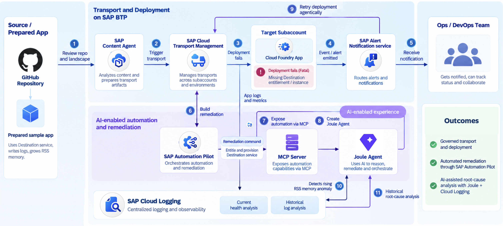

# XP260 - Deploy, review, break, fix: Govern cloud transports with agility and AI. 

## Description

This repository contains the material for the SAP TechEd 2026 session called XP260 - Deploy, review, break, fix: Govern cloud transports with agility and AI. 

## Overview
In this hands-on, we will follow the complete lifecycle of a cloud application — from deployment and transport, through failure detection and remediation, to AI-assisted operations and historical root-cause analysis.

## 1. Understand the application and landscape

We start with a prepared GitHub repository containing a sample application that is already configured for deployment on SAP BTP.

The application has two important characteristics:

- It depends on the SAP Destination service.
- It intentionally generates increasing RSS memory consumption and continuously writes corresponding application logs.

We then briefly review the SAP BTP landscape, consisting of a central subaccount hosting SAP Cloud Transport Management and a separate target subaccount where the application will be deployed.

## 2. Trigger the transport — and intentionally break it

Next, we trigger the application deployment through SAP Cloud Transport Management.

The transport fails with a **Fatal** status because the target subaccount does not yet have the required Destination service entitlement and service instance.

This gives us our first operational issue to investigate.

## 3. Detect the failure automatically

Instead of relying on someone manually monitoring the transport queue, the failure produces an event that is delivered through **SAP Alert Notification service**.

We review the notification and use it as the starting point for remediation.

## 4. Build an automated remediation

In **SAP Automation Pilot**, we create a remediation command that can automatically:

1. Add the required Destination service entitlement.
2. Provision the required service instance in the target subaccount.

We test the command and confirm that the missing dependency can now be created automatically.

The initial deployment problem is therefore no longer just something we know how to fix manually — it has become a reusable automation.

## 5. Expose the automation to AI through MCP

Next, we expose the relevant Automation Pilot commands through an **MCP server**.

This provides a standardized interface through which an AI agent can discover and execute the operational capabilities we have just created.

## 6. Build the Joule Agent

We move to **Joule Studio / Joule Work** and create an AI agent connected to the MCP server.

The agent now has access to operational capabilities provided by SAP Automation Pilot, including transport operations, remediation commands, application metrics, and log analysis.

## 7. Repeat the deployment — this time agentically

We now repeat the deployment scenario, but instead of navigating manually through the individual services, we interact with the Joule Agent.

We ask the agent to initiate the deployment.

Behind the scenes, the agent uses SAP Automation Pilot to interact with SAP Cloud Transport Management and trigger the transport.

When the deployment problem is detected, the agent can analyze the failure and identify the missing Destination service as the likely cause.

## 8. Let the agent remediate the problem

Because the remediation automation already exists in SAP Automation Pilot, the agent can use it directly.

The agent executes the command that adds the required entitlement and provisions the Destination service.

We then retry the deployment and verify that the transport can proceed successfully.

This demonstrates the transition from **manual troubleshooting** to **AI-assisted, automation-backed remediation**.

## 9. Perform an application health analysis

Deployment success does not necessarily mean that the application is healthy.

We therefore ask the Joule Agent to perform an application health check.

Using existing Automation Pilot commands, the agent collects application metrics and relevant logs, including information available through **SAP Cloud Logging**.

The analysis identifies an anomaly: the application's RSS memory consumption is continuously increasing.

## 10. Investigate the problem historically

Finally, we ask the agent to extend the investigation beyond the current deployment.

Using SAP Cloud Logging, it analyzes historical logs from previous days and potentially other instances of the application within the same landscape.

The agent discovers that the memory-growth pattern has been present for some time and is therefore not an isolated deployment issue.

Based on the collected metrics and historical log evidence, the Joule Agent produces a concise investigation report with:

- the detected anomaly,
- supporting log and metric evidence,
- the likely area requiring investigation,
- and recommended next steps.

## End-to-end takeaway

By the end of the hands-on, we have moved through the complete operational lifecycle:

**GitHub application → Cloud Transport Management → deployment failure → Alert Notification → Automation Pilot remediation → MCP → Joule Agent → automated recovery → application health analysis → Cloud Logging historical investigation.**

The key message is that these services do not operate in isolation. Together, they provide a blueprint for **governed cloud delivery combined with event-driven automation and AI-assisted operations**.

> **Workshop design recommendation:** Build the Automation Pilot remediation before introducing MCP/Joule, then reuse exactly the same automation through the agent. This reinforces the architectural message that AI does not replace deterministic automation; the agent reasons about the situation and invokes governed automation to perform the action.

---

## Requirements

The requirements to follow the exercises in this repository are...

## Exercises

Provide the exercise content here directly in README.md using [markdown](https://guides.github.com/features/mastering-markdown/) and linking to the specific exercise pages, below is an example.

- [Getting Started](exercises/ex0/)
- [Exercise 1 - First Exercise Description](exercises/ex1/)
    - [Exercise 1.1 - Exercise 1 Sub Exercise 1 Description](exercises/ex1#exercise-11-sub-exercise-1-description)
    - [Exercise 1.2 - Exercise 1 Sub Exercise 2 Description](exercises/ex1#exercise-12-sub-exercise-2-description)
- [Exercise 2 - Second Exercise Description](exercises/ex2/)
    - [Exercise 2.1 - Exercise 2 Sub Exercise 1 Description](exercises/ex2#exercise-21-sub-exercise-1-description)
    - [Exercise 2.2 - Exercise 2 Sub Exercise 2 Description](exercises/ex2#exercise-22-sub-exercise-2-description)

  
**OR** Link to the Tutorial Navigator for example...

Start the exercises [here](https://developers.sap.com/tutorials/abap-environment-trial-onboarding.html).

**IMPORTANT**

Your repo must contain the .reuse and LICENSES folder and the License section below. DO NOT REMOVE the section or folders/files. Also, remove all unused template assets(images, folders, etc) from the exercises folder. 

## Contributing
Please read the [CONTRIBUTING.md](./CONTRIBUTING.md) to understand the contribution guidelines.

## Code of Conduct
Please read the [SAP Open Source Code of Conduct](https://github.com/SAP-samples/.github/blob/main/CODE_OF_CONDUCT.md).

## How to obtain support

Support for the content in this repository is available during the actual time of the online session for which this content has been designed. Otherwise, you may request support via the [Issues](../../issues) tab.

## License
Copyright (20xx-)20xx SAP SE or an SAP affiliate company and <your-project> contributors. Please see our [LICENSE](LICENSE) for copyright and license information. Detailed information including third-party components and their licensing/copyright information is available [via the REUSE tool](https://api.reuse.software/info/github.com/SAP/<your-project>).
