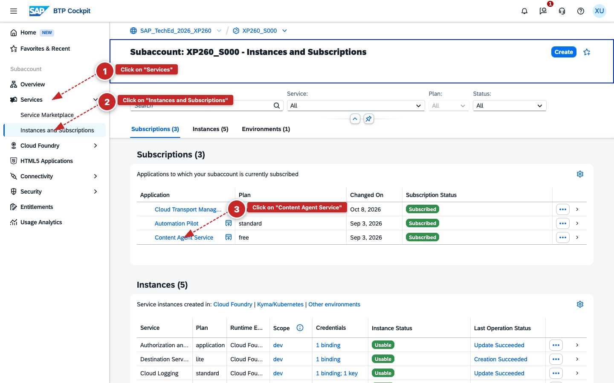
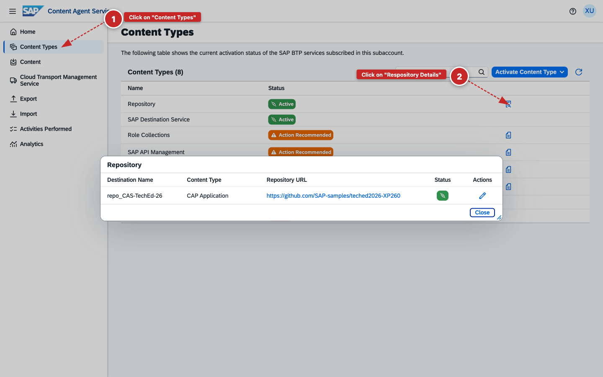
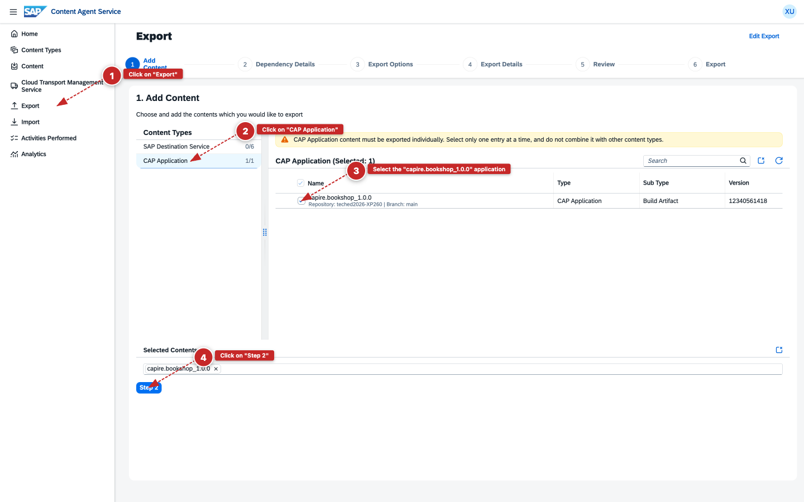
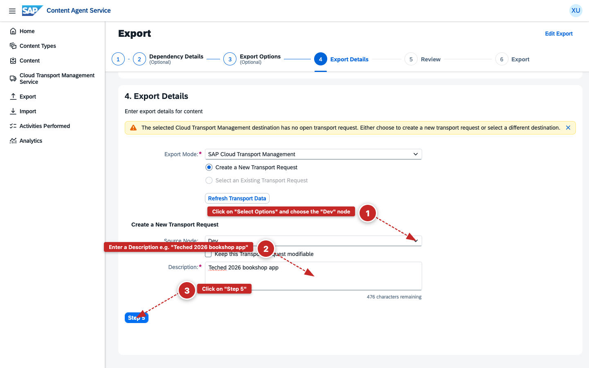
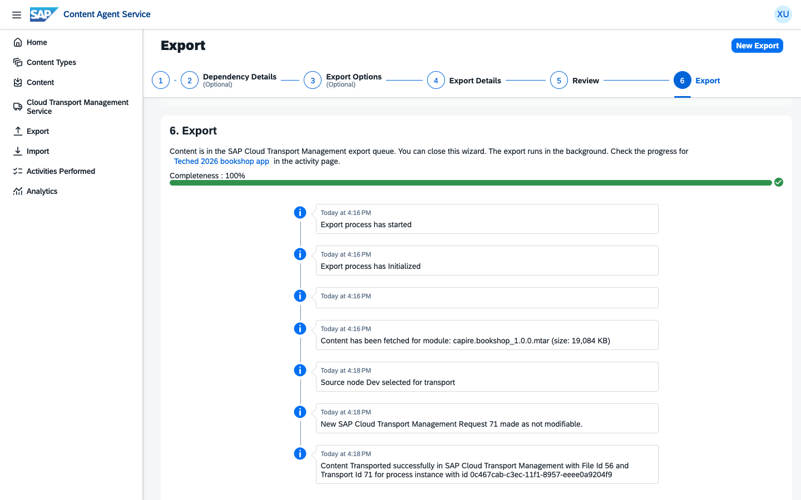

# Exercise 1 - Export an Application with SAP Content Agent Service

In this exercise, you will use SAP Content Agent Service to export a CAP bookshop application from its connected Git repository and create a transport request in SAP Cloud Transport Management. At the end, you will note the transport request ID that you will use in Exercise 2 to deploy the application.

> *The application is a CAP bookshop — a simple book catalog and order service, kept minimal so you can focus on the transport tooling. The target environment is intentionally missing a required Destination service instance, which causes the deployment to fail. This is a simplified but realistic scenario: deployments failing due to missing dependencies happen, especially in new or reset environments. The hands-on uses this controlled failure to practice detection and AI-assisted remediation with SAP Automation Pilot and Joule.*

Table of Contents

- [Exercise 1 - Export an Application with SAP Content Agent Service](#exercise-1---export-an-application-with-sap-content-agent-service)
      - [Prerequisites](#prerequisites)
  - [1.1 Open SAP Content Agent Service](#11-open-sap-content-agent-service)
      - [Exercise Summary](#exercise-summary)
  - [1.2 Export the Application](#12-export-the-application)
      - [Exercise Summary](#exercise-summary-1)
  - [Summary](#summary)

#### Prerequisites

You need access to your **source subaccount** (`XP260_S0XX`). If you need to sign in, follow the login instructions from the [General Section](../ex0/README.md).

---

## 1.1 Open SAP Content Agent Service

**Learning Objective**: Navigate to SAP Content Agent Service and understand how it connects to a Git repository to identify exportable content.

1. In the SAP BTP cockpit, navigate to your subaccount `XP260_S0XX` (e.g. **XP260_S001** — replace `01` with your seat number).

2. In the left navigation, go to **Services** > **Instances and Subscriptions**.

3. On the **Subscriptions** tab, find **Content Agent Service** and click the link to open it.

    

   *Content Agent Service subscription on the Instances and Subscriptions page*

4. When prompted to sign in, select **tdct3ched1.accounts.ondemand.com** as the identity provider — not the Default Identity Provider.

    

   *Select tdct3ched1.accounts.ondemand.com to sign in*

5. In Content Agent Service, click **Content Types** in the left navigation.

   Here you can see the content types that Content Agent Service supports. In this exercise we are using **Repository/CAP Application**, which is connected to a Git repository. Content Agent Service reads the application artifacts directly from there.

6. In the **Repository** row, click the **Repository Details** icon on the right to see the Git repository this content type is connected to.

    

   *Git repository details for the Git HTML5 Apps Repo content type*

7. Review the destination details, then click **Close**.

#### Exercise Summary

**Result**: You opened SAP Content Agent Service and confirmed that the **Repository/CAP Application** content type is connected to the bookshop application's Git repository.

> **Further Reading:** SAP Content Agent Service can push both CAP applications and SAP Integration Suite artifacts (such as Cloud Integration flows, scripts, and related configuration) directly from a Git repository to create transport requests in SAP Cloud Transport Management. See [Transport CAP Apps and Integration Artifacts Directly from Git with SAP Content Agent Service](https://community.sap.com/t5/technology-blog-posts-by-sap/transport-cap-apps-and-integration-artefacts-directly-from-git-with-sap/ba-p/14497880).

---

## 1.2 Export the Application

**Learning Objective**: Export the CAP bookshop application and create a transport request in SAP Cloud Transport Management targeting the Dev node.

1. In the left navigation, click **Export**.

2. Select **CAP Application** as the content type.

3. From the list, select **capire.bookshop_1.0.0.mtar** — this is the bookshop application from the connected Git repository. Click **Step 2**.

    

   *Selecting capire.bookshop_1.0.0.mtar for export*

4. On **Step 2** (Dependency Details) and **Step 3** (Export Options), keep the default settings and proceed to **Step 4**.

5. On **Step 4 – Export Details**, configure the transport request:
   1. Click **Select Options** next to the transport destination and choose the **Dev** node.
   2. In the **Description** field, enter a meaningful description, e.g. `TechEd 2026 bookshop app`.
   3. Click **Step 5**.

    

   *Export Details: selecting the Dev node and entering a transport description*

6. On **Step 5 – Review**, verify the export configuration and click **Step 6**.

7. On **Step 6 – Export**, click **Export** to start the process and wait for the export to complete.

   Once finished, the transport request appears on the page with its ID. **Note down the transport request ID** — you will need it in Exercise 2 to import and deploy the application.

    

   *Export completed — the transport request ID is displayed*

Congratulations! You have successfully exported the bookshop application. SAP Content Agent Service packaged the application from Git and created a transport request in SAP Cloud Transport Management.

#### Exercise Summary

**Result**: You exported the CAP bookshop application and created a transport request targeting the **Dev** node in SAP Cloud Transport Management.

**Key Capabilities Demonstrated:**

- ✅ **Git-connected export** — Content Agent Service reads application artifacts directly from a connected Git repository
- ✅ **Transport request creation** — a versioned transport request is now queued in SAP Cloud Transport Management, ready for deployment

---

## Summary

You have used SAP Content Agent Service to export a CAP application from a connected Git repository and create a transport request targeting the **Dev** node in SAP Cloud Transport Management.

Continue to - [Exercise 2 - Import a Transport Request with SAP Cloud Transport Management](../ex2/README.md)
