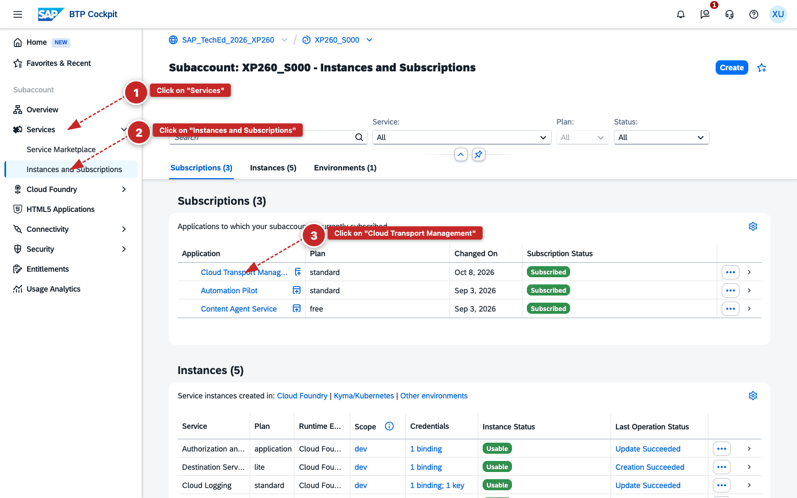
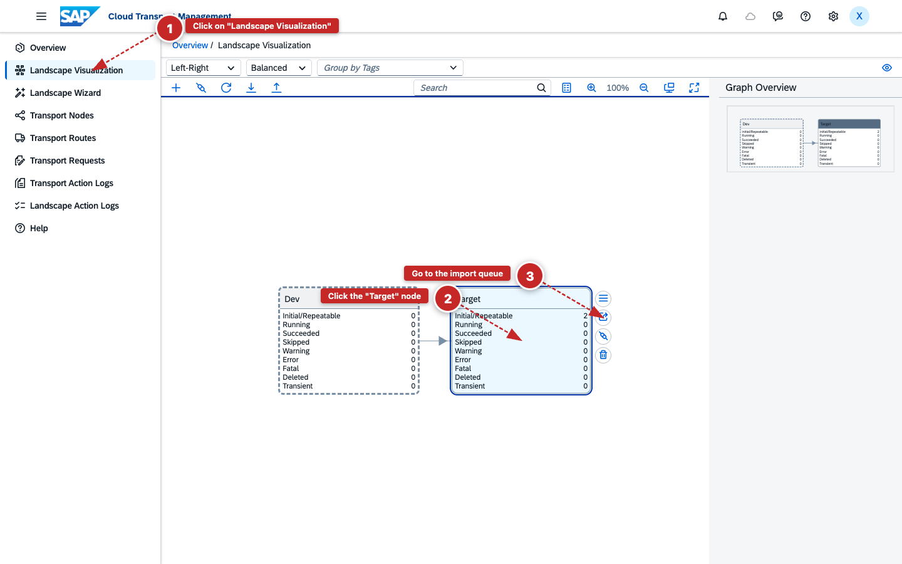
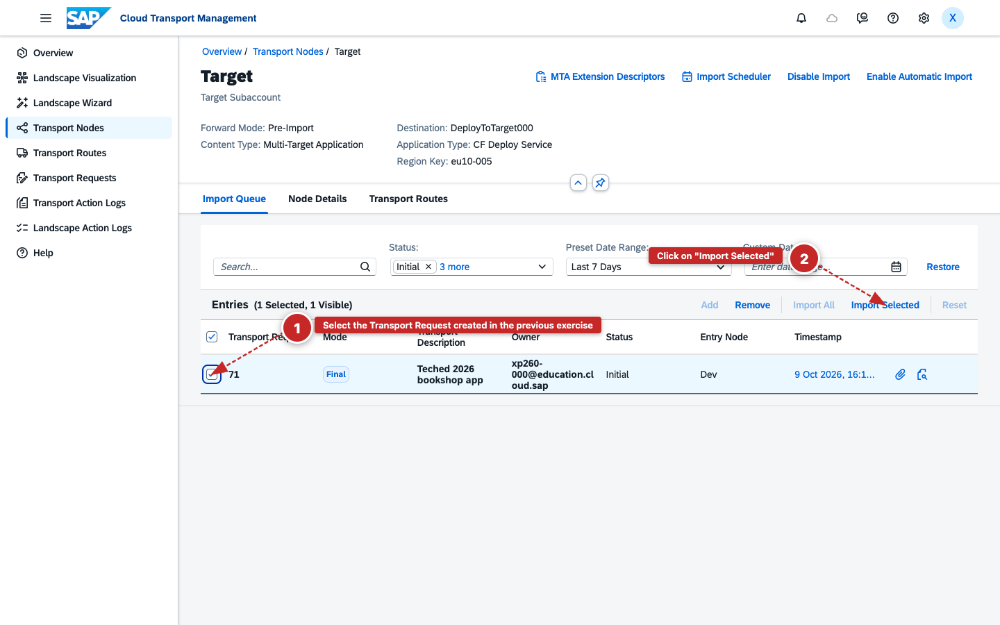
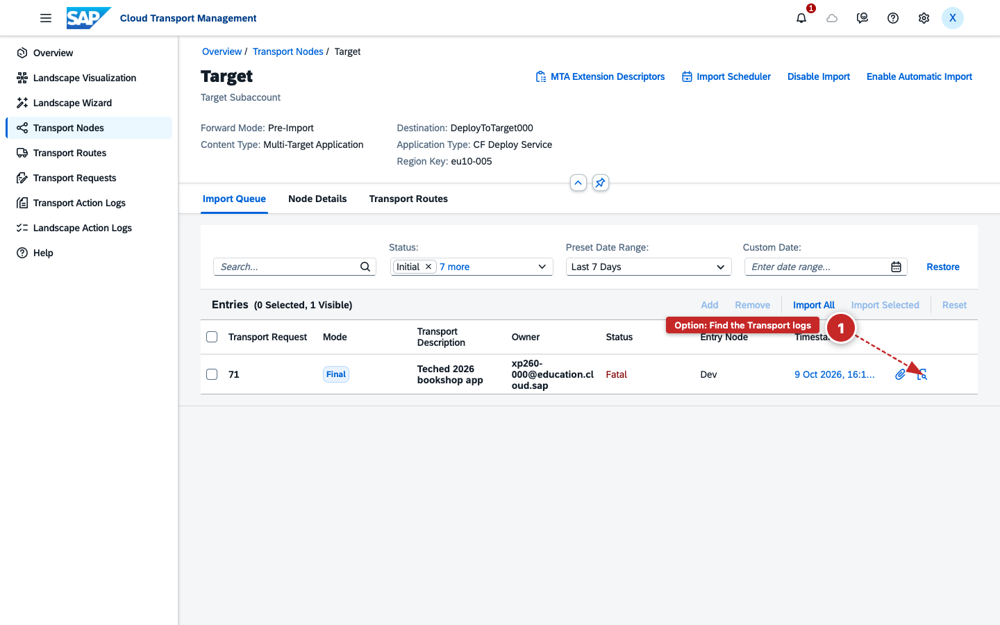
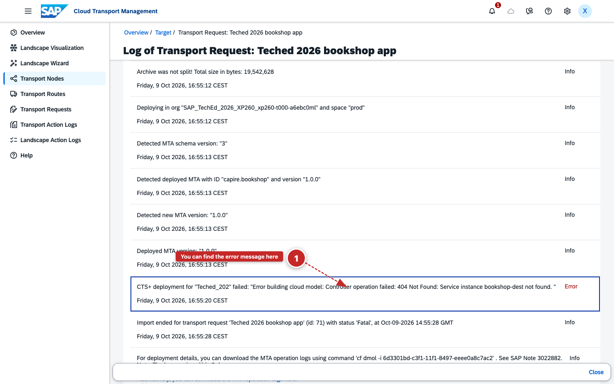

# Exercise 2 - Import a Transport Request with SAP Cloud Transport Management

In this exercise, you will use SAP Cloud Transport Management to import the transport request created in Exercise 1. The import will end with a **Fatal** status — this is intentional and the starting point for the next exercise, where you will detect and fix the underlying problem using SAP Automation Pilot.

Table of Contents

- [Exercise 2 - Import a Transport Request with SAP Cloud Transport Management](#exercise-2---import-a-transport-request-with-sap-cloud-transport-management)
      - [Prerequisites](#prerequisites)
  - [2.1 Open SAP Cloud Transport Management](#21-open-sap-cloud-transport-management)
      - [Exercise Summary](#exercise-summary)
  - [2.2 Import the Transport Request](#22-import-the-transport-request)
      - [Exercise Summary](#exercise-summary-1)
  - [Summary](#summary)

#### Prerequisites

You need access to your **source subaccount** (`XP260_S0XX`), where SAP Cloud Transport Management is subscribed. If you need to sign in, follow the login instructions from the [General Section](../ex0/README.md).

---

## 2.1 Open SAP Cloud Transport Management

**Learning Objective**: Navigate to SAP Cloud Transport Management and understand the transport landscape, which shows the nodes that connect your source and target environments.

1. In the SAP BTP cockpit, navigate to your subaccount `XP260_S0XX` (e.g. **XP260_S001** — replace `01` with your seat number).

2. In the left navigation, go to **Services** > **Instances and Subscriptions**.

3. On the **Subscriptions** tab, find **Cloud Transport Management** and click the link to open it.

    

   *Cloud Transport Management subscription on the Instances and Subscriptions page*

4. When prompted to sign in, select **tdct3ched1.accounts.ondemand.com** as the identity provider — not the Default Identity Provider.

    

   *Select tdct3ched1.accounts.ondemand.com to sign in*

5. In Cloud Transport Management, click **Landscape Visualization** in the left navigation.

   The landscape shows the transport nodes configured for your environment. You will import into the **Target** node, which represents your target subaccount.

#### Exercise Summary

**Result**: You opened SAP Cloud Transport Management and reviewed the transport landscape showing the **Target** node where you will deploy the application.

---

## 2.2 Import the Transport Request

**Learning Objective**: Import the transport request into the Target node and observe the Fatal status caused by a missing dependency in the target environment — the deliberate failure you will fix in the next exercises.

1. In the landscape diagram, click the **Target** node to select it.

2. Click the import queue icon on the **Target** node to open its import queue.

    

   *Transport landscape — clicking the import queue icon on the Target node*

3. In the **Import Queue**, find and select the transport request you created in Exercise 1. You can identify it by the transport request ID you noted down, or by the description you entered, e.g. **TechEd 2026 bookshop app**.

4. Click **Import Selected** to start the deployment to your target subaccount.

    

   *Selecting the transport request and clicking Import Selected*

   The transport will end with a **Fatal** status. This is expected — the target subaccount is missing a required service configuration, which we will fix in the next exercise.

5. (Optional) Click the transport logs icon next to the transport request entry to open the logs.

    

   *Transport logs icon for the failed transport request*

6. (Optional) In the log, expand the **Import to Node** action to see the error message. This tells you exactly what is missing and will be useful context for the next exercise.

    

   *Expanded import log — the error message shows the missing service configuration*

#### Exercise Summary

**Result**: You imported the transport request into the **Target** node and observed the **Fatal** status, confirming that the target subaccount is missing a required dependency.

**Key Capabilities Demonstrated:**

- ✅ **Transport landscape** — SAP Cloud Transport Management models the deployment path from source to target as a node-based landscape
- ✅ **Event-driven failure** — the Fatal status triggers an event in SAP Alert Notification Service (Exercise 3), which you will use to begin the automated remediation

---

## Summary

You have used SAP Cloud Transport Management to trigger a deployment to the **Target** node. The transport failed with a Fatal status because the target subaccount is missing a required dependency — which is exactly the operational problem we will now solve.

Continue to - [Exercise 3 - Detect the Failure Automatically with SAP Alert Notification Service](../ex3/README.md)
