# Exercise 3 - Detect the Failure Automatically with SAP Alert Notification Service

In this exercise, you will see how the transport failure from Exercise 2 is detected automatically by **SAP Alert Notification Service (ANS)**. Instead of someone manually watching the transport queue, ANS matches the failure event the moment it happens and keeps it for you to retrieve — giving you an immediate, actionable starting point for remediation.

> **Context:** SAP Alert Notification Service receives events from BTP services (here, SAP Cloud Transport Management) and routes them according to **conditions** (which events to match) and **actions** (what to do with a match). In a real operations setup, ANS delivers these matches **instantly** to the channels your team already uses — **email**, **Microsoft Teams** or **Slack** messages, **webhooks**, **SMS**, and more — so an operator is notified the moment something breaks.
>
> **For this hands-on**, those instant channels are not practical: the workshop infrastructure does not provide a personal email inbox or chat workspace for each participant. Instead, the subscription uses the **Store** action, which buffers each matched event in your own subaccount's ANS instance. You then retrieve and visualize the event's content with a ready-made **SAP Automation Pilot** command — giving you the same information an email or Teams alert would carry, in a way that works for everyone in the room.

#### Prerequisites

You need access to your **source subaccount** (`XP260_S0XX`), where SAP Cloud Transport Management and SAP Alert Notification Service are set up for you. The ANS **condition** and **Store action** that capture the transport-failure event are **pre-configured** — you do not need to create them. If you need to sign in, follow the login instructions from the [General Section](../ex0/README.md).

---

## Exercise 3.1 - Review the Alert Notification Configuration

**Learning Objective**: Understand how SAP Alert Notification Service is set up to detect the transport failure automatically, so that the event is captured without any manual monitoring.

#### Step 1. Open the Alert Notification Service Instance

1. Open the **BTP Cockpit** and navigate to your source subaccount (`XP260_S0XX`).
2. Go to **Services → Instances and Subscriptions**.
3. Under **Instances**, open the **Alert** instance (service: *Alert Notification Service*).

 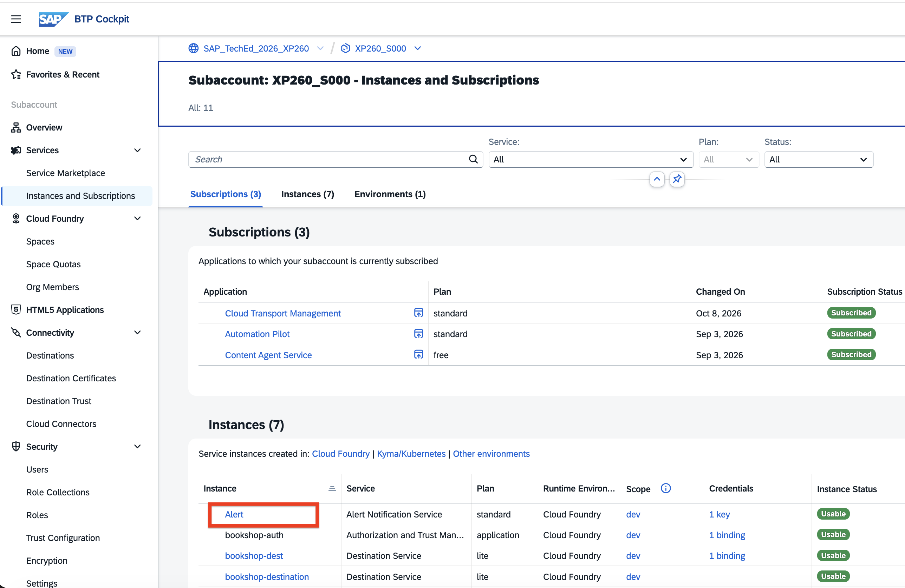

#### Step 2. Review the Conditions

In the Alert instance, open the **Conditions** tab. These define *which* events the service reacts to. Three conditions are pre-configured:

- **severityFatal** — matches events with `FATAL` severity.
- **severityError** — matches events with `ERROR` severity.
- **ctmsImportFinished** — matches the Cloud Transport Management import-finished event type.

 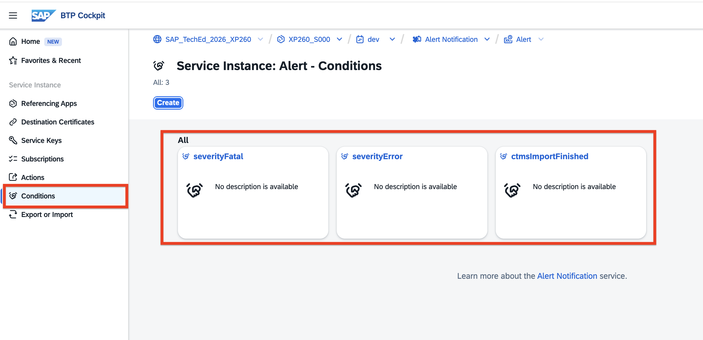

#### Step 3. Review the Store Action

Open the **Actions** tab. Actions define *what happens* when a condition matches. One action is pre-configured:

- **storedAction** — type **Store**, enabled. It buffers each matched event in this subaccount's ANS instance so it can be retrieved later ("Stored action for ANS instance on my Source subaccount").

 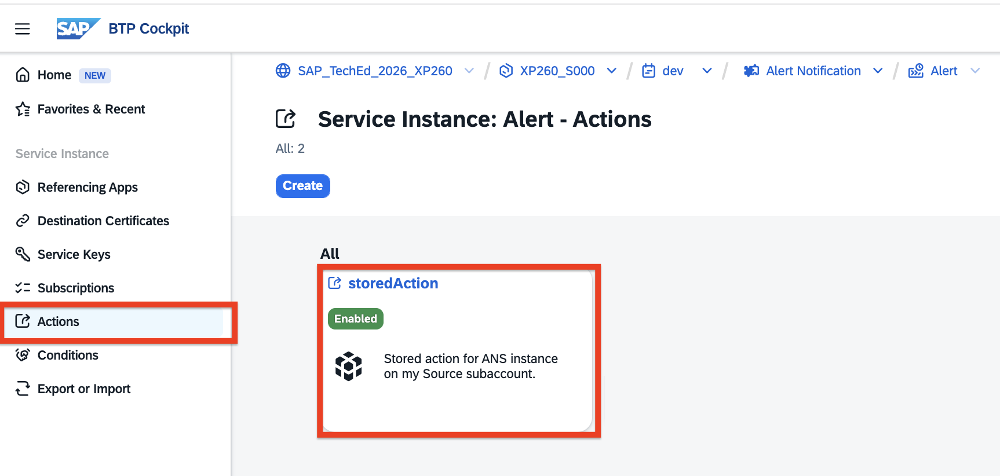

#### Step 4. Review the Subscription

Open the **Subscriptions** tab and open the **ctmsTransportFailed** subscription. A subscription ties conditions and actions together.

 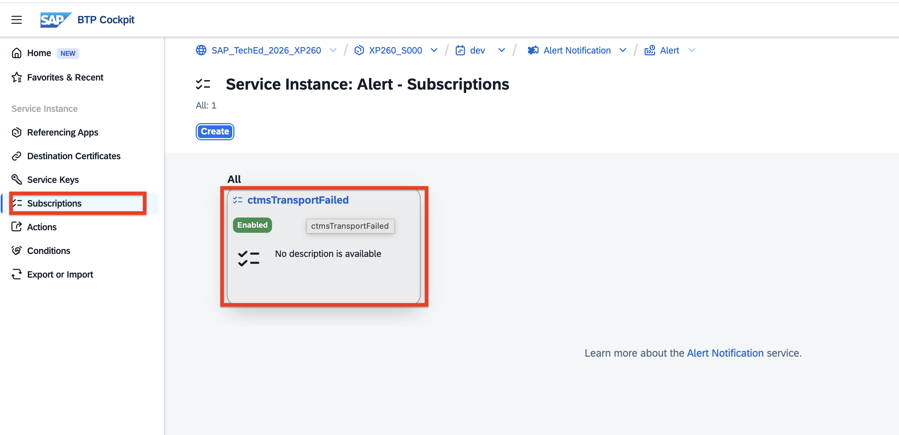

On the subscription overview, look at the **Matching Conditions**: the subscription matches an event when **eventType *Is Equal To* TmsImportFinished** **and** **severity *Is Equal To* ERROR or FATAL** — in other words, a Cloud Transport Management import that finished with a failure. That is exactly the transport failure from Exercise 2.

 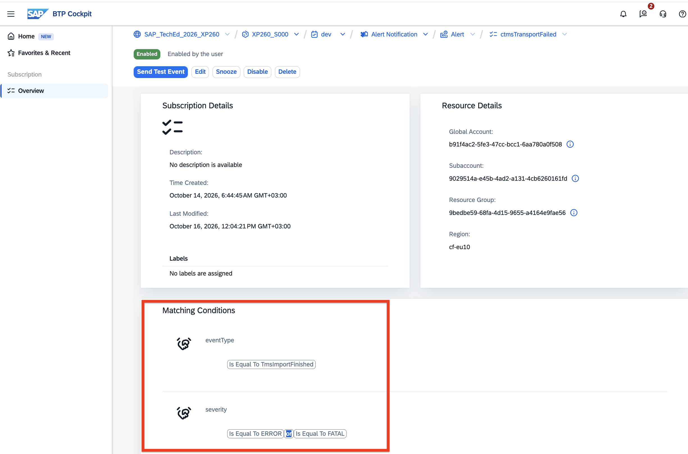

> **Why Store instead of email or Teams?** SAP Alert Notification Service can deliver a matched event **instantly** to many channels. If you choose **Create** on the Actions tab, you can see the available action types — **Email**, **Email Destination**, **Email with custom SMTP server**, **Microsoft Teams**, **PagerDuty**, **SAP Automation Pilot**, and more. In a production setup you would attach one of these to be notified the moment something breaks.
>
> For this hands-on, the workshop infrastructure does not give each participant a personal email inbox or chat workspace, so a push channel would not reach you. That is why the subscription uses the **Store** action instead: it keeps each participant's matched events in their *own* subaccount's ANS instance, and in the next exercise step you retrieve and read them with SAP Automation Pilot — seeing exactly the content an email or Teams message would have carried, and only *your own* transport failure.

 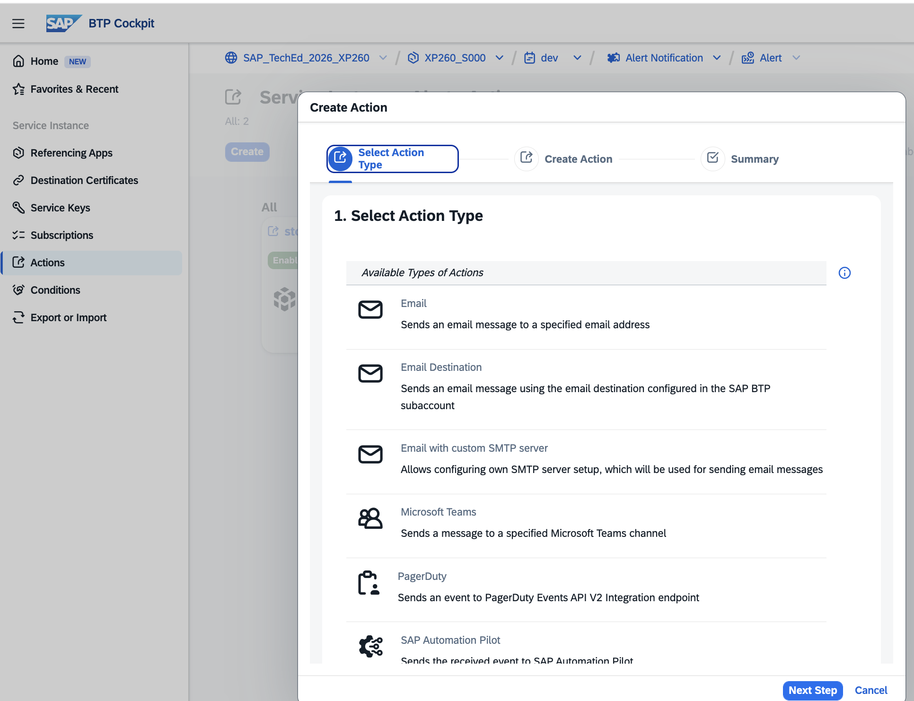

> **Note:** You only *review* this configuration — it is already in place. You will not receive an email or chat message; instead, you will *pull* the stored event in the next step.

#### Exercise Summary

You reviewed how SAP Alert Notification Service automatically matches the transport-failure event (`TmsImportFinished` with `ERROR`/`FATAL` severity) and stores it with the **storedAction** — detection happens with no manual monitoring on your part.

---

## Exercise 3.2 - Receive and Review the Notification

**Learning Objective**: Retrieve the stored transport-failure event using a ready-made SAP Automation Pilot command and read the alert that was captured for you.

Because the matched event is stored in your subaccount's ANS instance, you can retrieve it on demand. A SAP Automation Pilot command has been **pre-configured** for you that reads the stored events — it wraps the provided building block **`ans-sapcp:ListMatchedAnsEvents:1`** and injects your ANS credentials automatically.

#### Step 1. Open SAP Automation Pilot

1. In the **BTP Cockpit**, go to **Services → Instances and Subscriptions**.
2. Under **Subscriptions**, open the **Automation Pilot** application (**Go to Application**).

 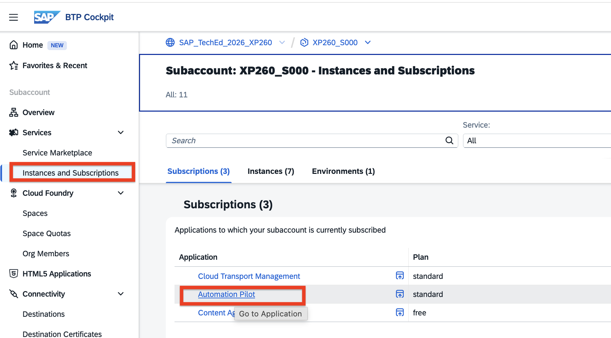

3. On the sign-in page, select your identity provider (for example `tdct3ched1.accounts.ondemand.com`) and log in.

 

#### Step 2. Find the Command

1. In the SAP Automation Pilot navigation, open **Catalogs** (under *Content Management*).

 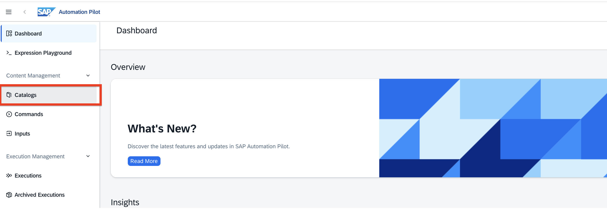

2. Open the **01-AutomatedSetup** catalog (`01XP260-...`).

 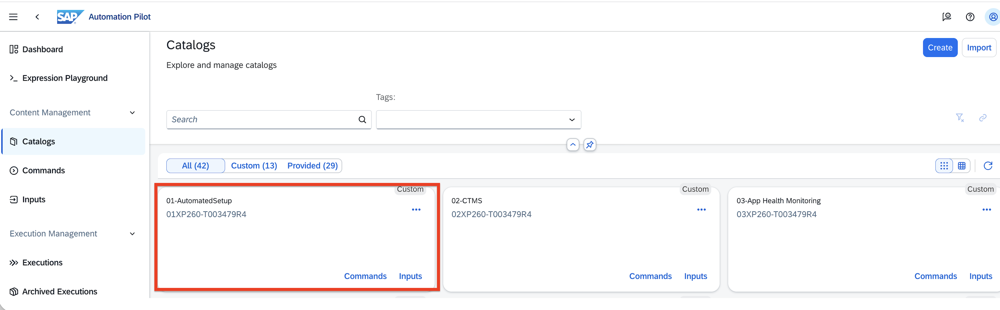

3. Open **Commands** and select **XP260GetStoredAlerts** — *"Retrieve the transport-failure alerts stored by SAP Alert Notification Service."*

 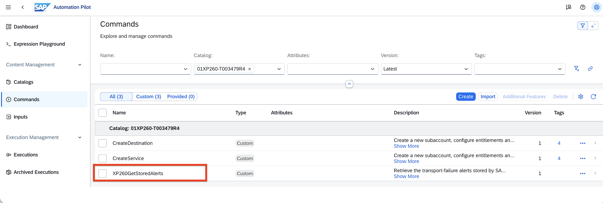

#### Step 3. Trigger the Command

On the command page, review the **Contract**: the inputs (`pageSize`, and `serviceKey` which defaults to your stored `targetEnvironment` input) and the outputs. Then choose **Trigger**.

 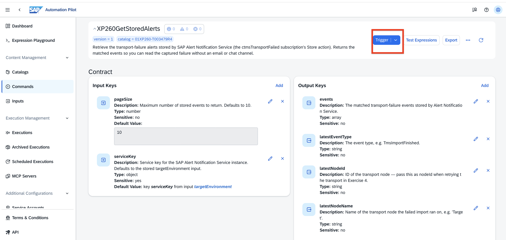

In the **Trigger Command** dialog, you do not need to enter anything — `pageSize` defaults to 10 and `serviceKey` is injected automatically. Choose **Trigger**.

 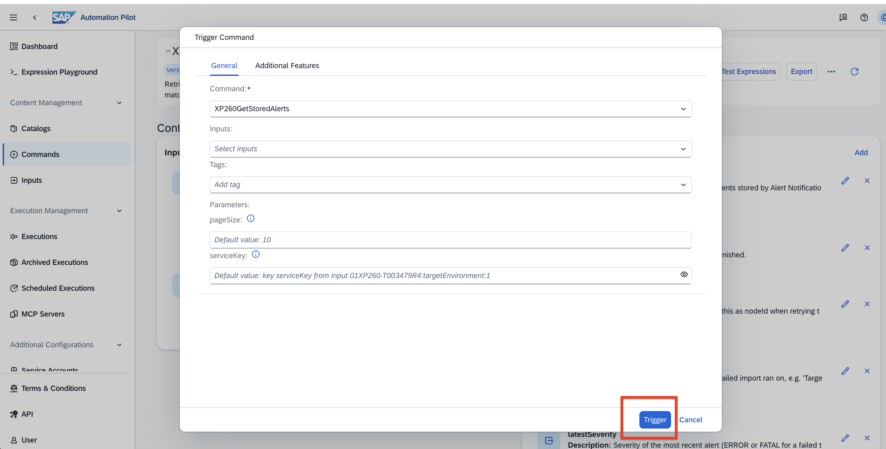

#### Step 4. Open the Execution Output

When the execution **Status** shows **Finished**, choose **Output → Show**.

 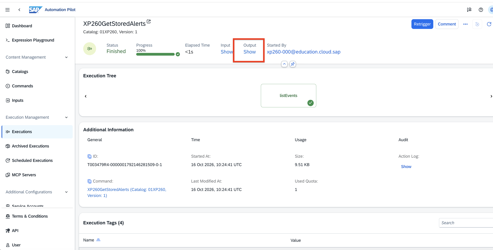

#### Step 5. Review the Captured Alert

The command surfaces the key facts of your most recent stored alert as ready-to-read values:

- **latestSubject** — e.g. `Import Finished in the 'Target' node`
- **latestSeverity** — e.g. `FATAL`
- **latestEventType** — e.g. `TmsImportFinished`
- **latestNodeName** — e.g. `Target`
- **latestNodeId** — e.g. `21` → you will pass this as the **node id** when you retry the transport in Exercise 4
- **latestTransportRequestIds** — e.g. `[848]` → the **transport request id** to retry in Exercise 4
- **totalResultsCount** — how many stored events matched

 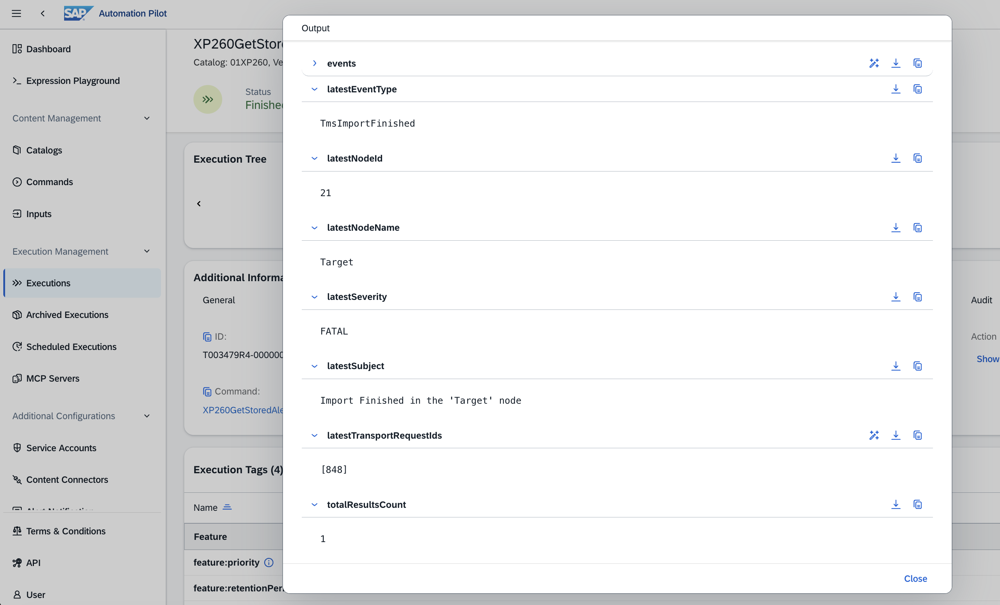

The full raw event is also available under **events**, including the metadata, severity, affected resource (*SAP Cloud Transport Management Service*), and the `transportRequestIds` / `nodeId` tags.

 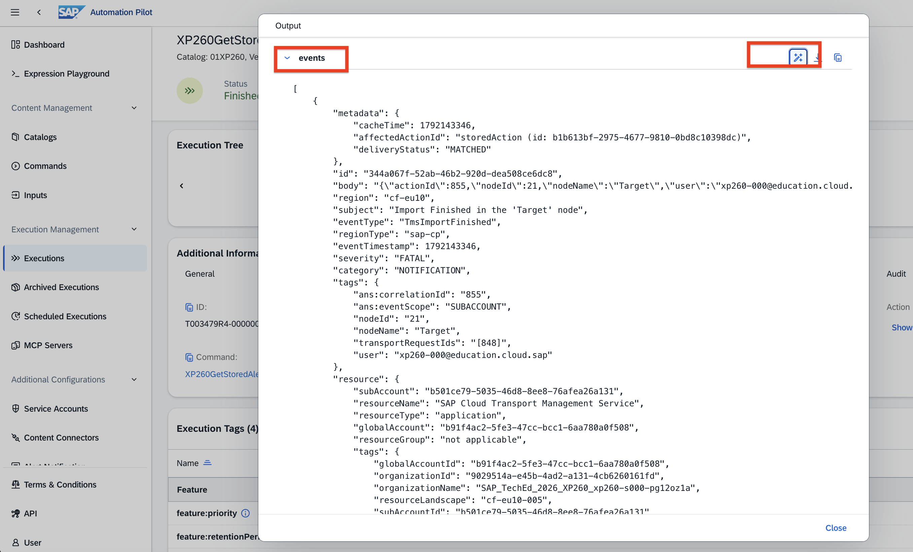

This is your automatically-detected signal to act: the system captured the failure for *you*, rather than you having to discover it by polling the transport queue. Note the **transport request id** and **node id** — you will use them in Exercise 4 to remediate and retry the transport.

> **Note:** Because each participant uses their own source subaccount's ANS instance, you see only **your own** transport-failure event.

#### Exercise Summary

You retrieved and reviewed the stored transport-failure alert that SAP Alert Notification Service captured automatically, and noted the transport request id and node id it reported. You now have a clear, event-driven starting point for the remediation you will build and run in the next exercise.

---

## Summary

You have seen how SAP Alert Notification Service detects a transport failure automatically and stores the event, and you retrieved your own alert through a ready-made SAP Automation Pilot command — all without manual monitoring, email, or chat. This event-driven detection is the trigger for the remediation you will build next.

Continue to - [Exercise 4 - Build an Automated Remediation with SAP Automation Pilot](../ex4/README.md)
