# Exercise 4 - Build an Automated Remediation with SAP Automation Pilot

In this exercise, you will use SAP Automation Pilot to create a remediation command that automatically adds the required Destination service entitlement and provisions the service instance in the target subaccount. You will then run the command to fix the deployment failure from Exercise 2 and trigger a new successful transport.

## Exercise 4.1 - Create a Remediation Command

**Learning Objective**: Build a reusable SAP Automation Pilot command from scratch that provisions the missing **Destination service** instance in your target subaccount — the dependency whose absence caused the transport to fail in Exercise 2.

You will compose your command on top of the SAP-provided command  **`CreateCfServiceInstance`**, which creates a service instance in a Cloud Foundry space. Your finished command, **`XP260CreateDestination`**, is a thin wrapper that pre-fills the destination-specific values and injects your environment and credentials, so that at run time you only supply the instance name.

> **Context:** SAP Automation Pilot organizes automations into **catalogs** of **commands**. A command is built from one or more **executors** (reusable building blocks). Reusable values such as credentials and your target environment are stored once as **inputs** and referenced by commands , so you never paste secrets into a command definition. In this exercise these inputs are **pre-configured for you**.

#### Step 1. Review the Pre-Configured Inputs

First, let's navigate to your Automation Pilot: 

1. In the SAP BTP cockpit, navigate to your subaccount `XP260_S0XX` (e.g. **XP260_S001** — replace `01` with your seat number).

2. In the left navigation, go to **Services** > **Instances and Subscriptions**.

3. On the **Subscriptions** tab, find **Automation Pilot** and click the link to open it.
<br>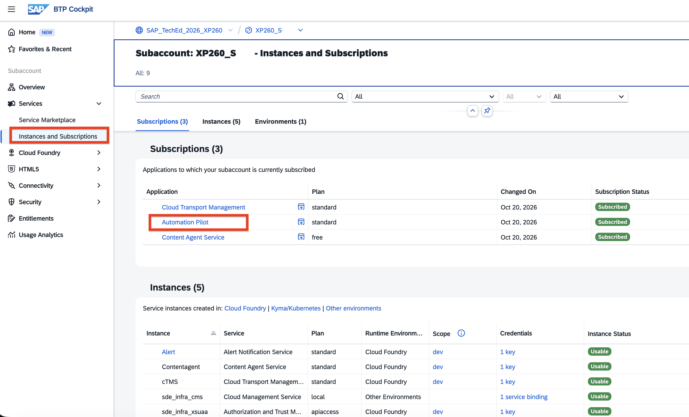
   
Note: if prompted to sign in, select **tdct3ched1.accounts.ondemand.com** as the identity provider — not the Default Identity Provider.

   <br>

   *Select tdct3ched1.accounts.ondemand.com to sign in*

Welcome to Automation Pilot - now you see the Automation Pilot dashboard: 
<br>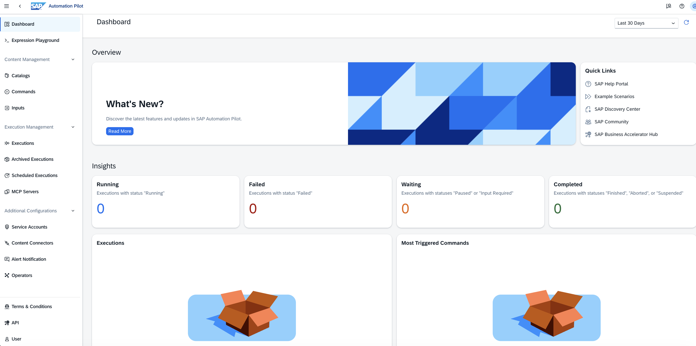

Before building the command, look at the **inputs** already set up in your catalog. Open **Catalogs**, and on the **01-AutomatedSetup** catalog choose **Inputs**.

<br>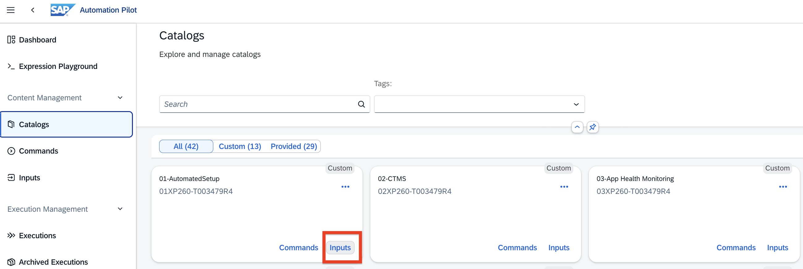

Two inputs are available:

- **`targetEnvironment`** — holds your Cloud Foundry target details.
- **`techUser`** — holds the technical user `user` and `pass` used to authenticate against Cloud Foundry.

<br>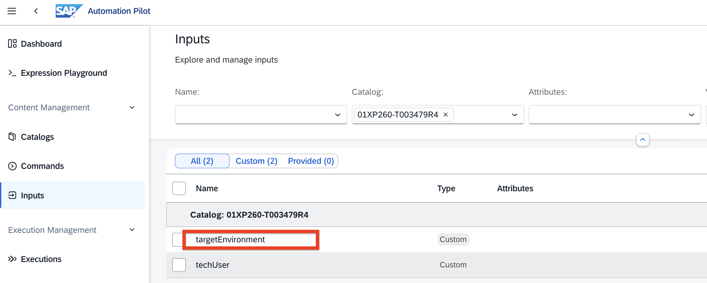

Open **`targetEnvironment`** to see its keys: `org` (the organization GUID), `region` (e.g. `cf-eu10-005`), `space` (e.g. `prod`), and `serviceKey`.

<br>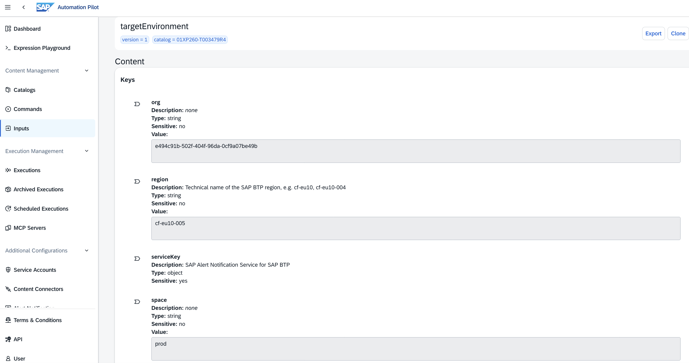

> **Note:** You do not edit these inputs. You will simply *reference* them from your command so their values are injected automatically at run time.

#### Step 2. Create a New Command

1. Go back to **Catalogs** and on **01-AutomatedSetup** choose **Commands**.
<br>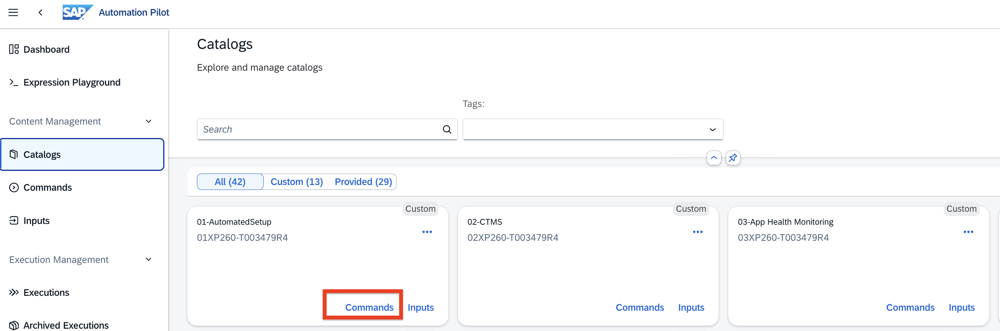

2. Choose **Create**.
<br>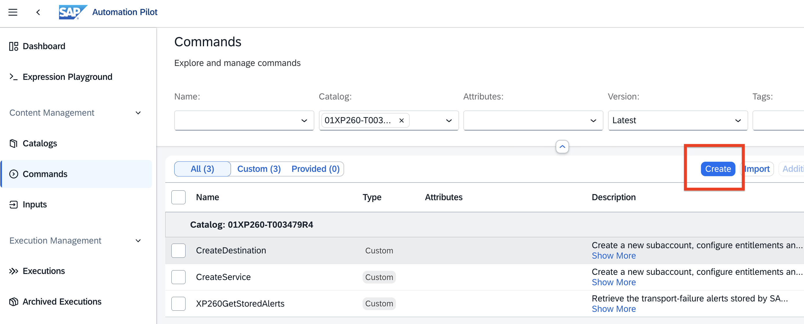

3. In the **Create Command** dialog, keep the catalog as **01-AutomatedSetup**, set the **Name** to **`XP260CreateDestination`**, add a description such as *"Provision the Destination service instance in the target subaccount."*, and choose **Create**.
<br>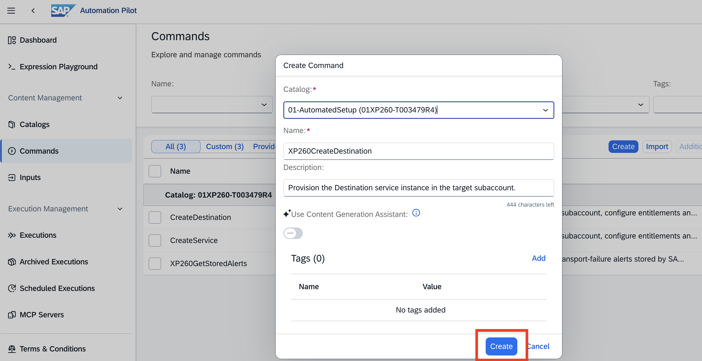

The new command opens with an empty **Contract** (no input or output keys yet) and an empty **Configuration**.
<br>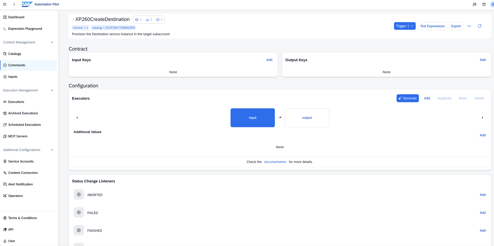

#### Step 3. Add the Input Keys and Bind Them to the Stored Inputs

First, let's define the command's **Input Keys**. 
In the **Contract → Input Keys** section, choose **Add** for each key below.
<br>

Now, let's create the needed inputs one by one. 

**`instanceName`** — Name `instanceName`, Type `string`, **Required** "enabled" and click the "Add" button.

<br>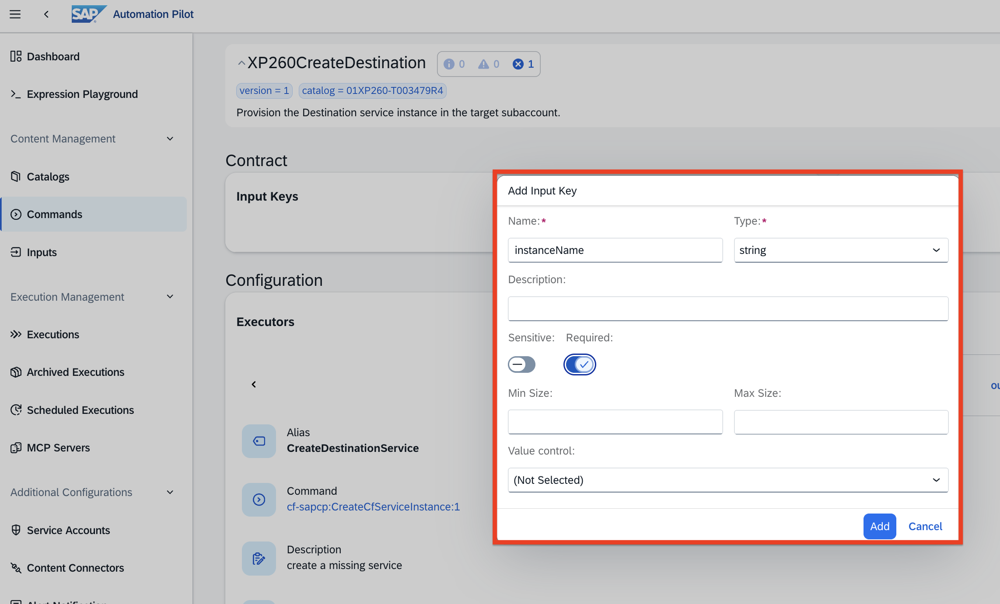

**`org`** — bound to the stored environment. Name `org`, Type `string`, **Default Value Source: Input Key**, and from the drop-down you need to map the input to **Input: `targetEnvironment`**, **Input Key: `org`**.

<br>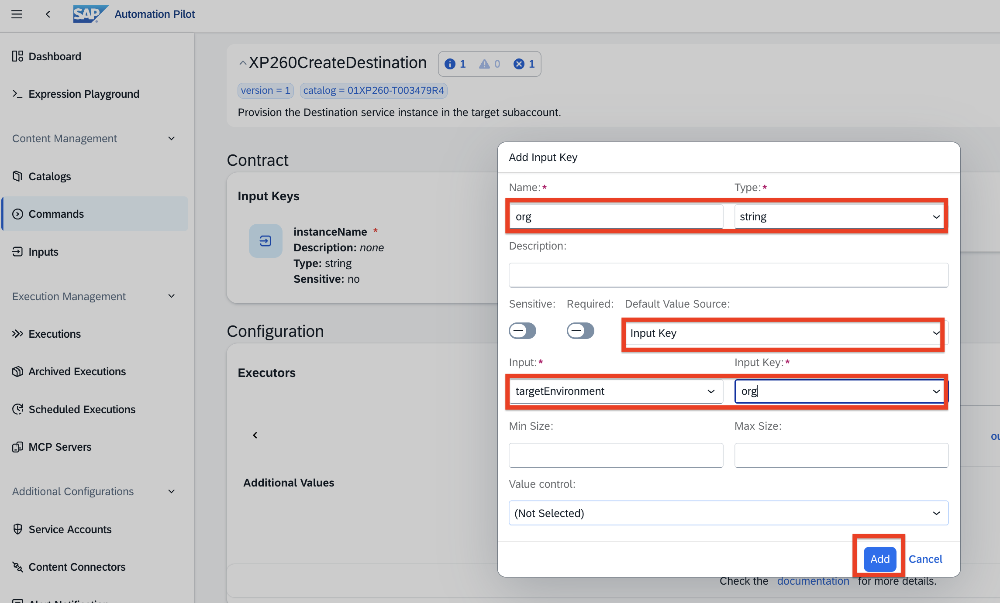

**`password`** — bound to the technical user. Name `password`, Type `string`, **Sensitive** on, **Default Value Source: Input Key**, and from the drop-down you need to map the input to **Input: `techUser`**, **Input Key: `pass`**.

<br>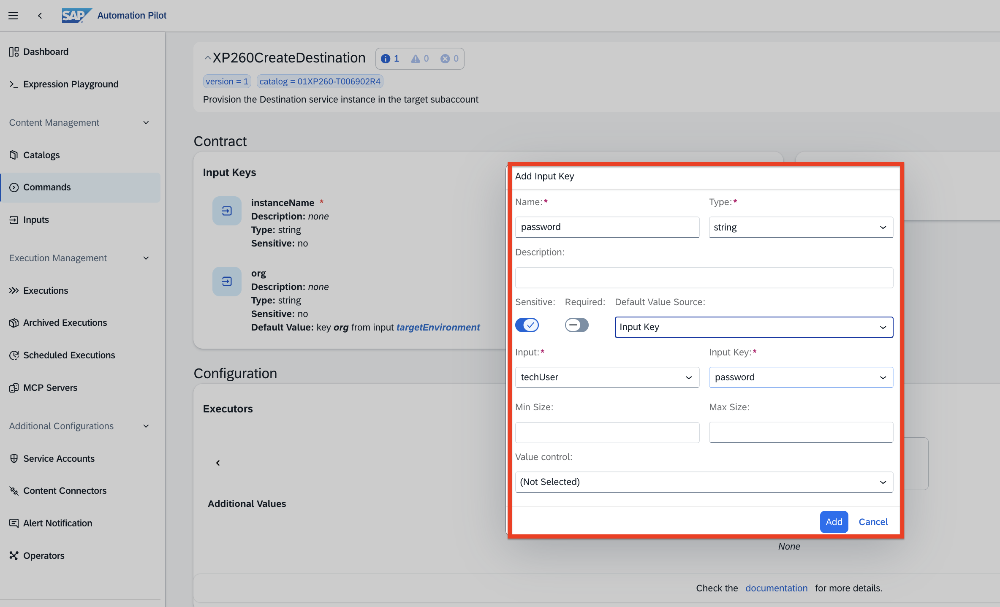

**`user`** — bound to the technical user. Name `user`, Type `string`, **Default Value Source: Input Key**, and from the drop-down you need to map the input to **Input: `techUser`**, **Input Key: `user`**.

<br>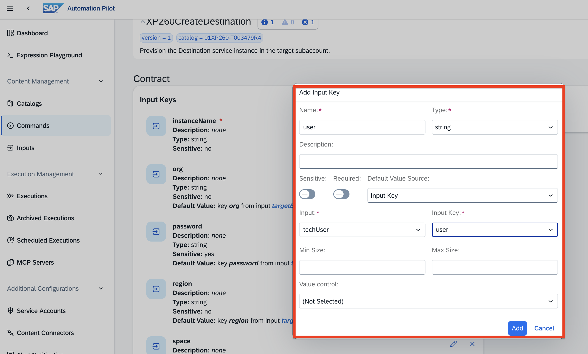

Add **`region`** and **`space`** the same way, both bound to **`targetEnvironment`** (**region** mapped to `region` and **space** mapped to `space`). 

When done, your Input Keys show each binding — `org`, `region`, `space` from **targetEnvironment**, and `user`, `password` from **techUser**:
<br>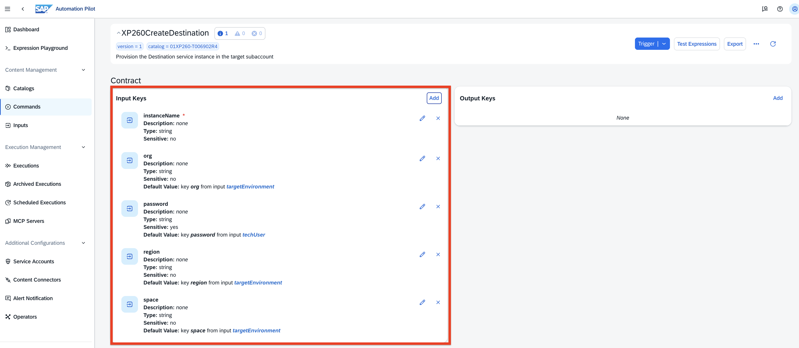

> **Note:** Binding an input key's default to a stored input is what lets the command run **without** you typing credentials or environment details — exactly the pattern a Joule AI agent relies on in Exercise 6.

#### Step 4. Add the Executor (with Automap)

You will add the executor **first** — with **Automap parameters** enabled, Automation Pilot inspects the chosen command and offers to create matching input keys for you.

1. In the **Configuration → Executors** section, choose **Add**.
<br>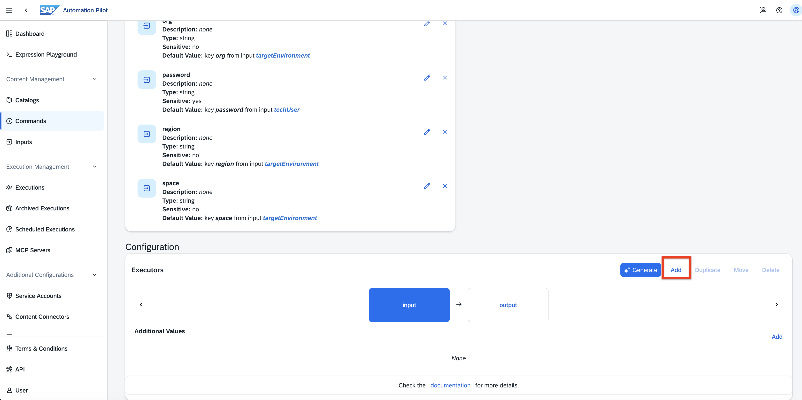

2. In the **Add Executor** dialog:
   - **Executor Location**: **Here**
   - **Alias**: `CreateDestinationService`
   - **Command**: **`CreateCfServiceInstance`** (`cf-sapcp:CreateCfServiceInstance:1`)
   - **Description**: e.g. *"create missing service instance"*
   - **Automap parameters**: **enabled**
3. Choose **Add**.

<br>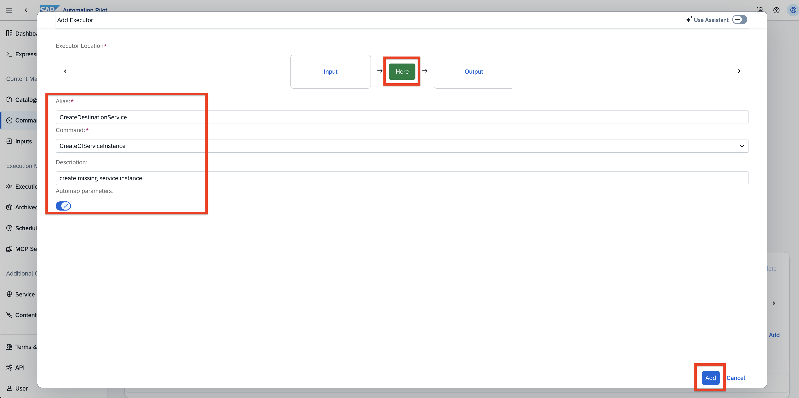

The executor now appears in the flow (**input → CreateDestinationService → output**). Its parameters are listed, but a few still show `None` — you will fill those next.

<br>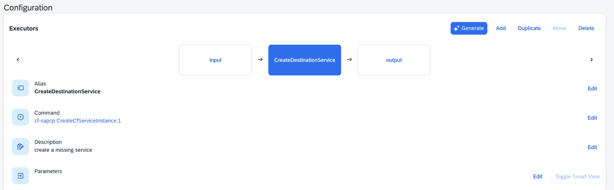

#### Step 5. Set the Fixed Values on the Executor

The automapped parameters resolve `instanceName`, `org`, `region`, `space`, `user` and `password` to `$(.execution.input.*)`. 
Two parameters remain to be set with **fixed** values that define *what* to create. In the executor's **Parameters** section, choose **Edit**.

<br>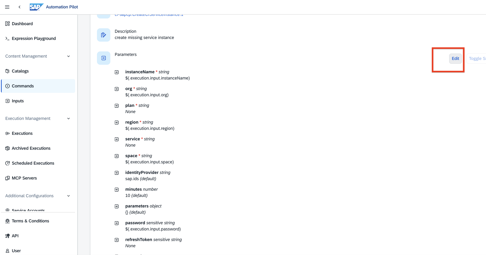

In the **Update Values** dialog, set:

- **plan** = `lite`
- **service** = `destination`

Leave the automapped expressions as they are (and `identityProvider` at its default `sap.ids`). Choose **Update**.

<br>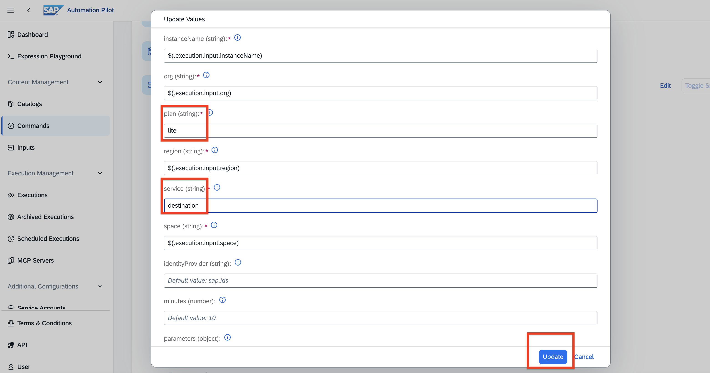

#### Step 6. Look into the Command

Your command is now complete and ready. The **Input Keys** show every binding, and the executor is set to create a `destination` service on the `lite` plan.

<br>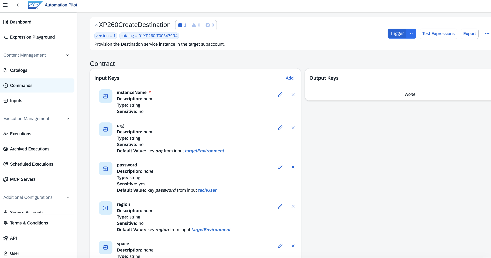

> **Note:** Your command is functionally equivalent to the reference command `XP260CreateDestination`: a one-executor wrapper around `CreateCfServiceInstance` provided command in SAP Automation Pilot which is not configured to provisions the `destination` service with plan `lite` , with everything except `instanceName` (that is to be defined dynamically at the moment the command runs), all resolved automatically from the stored inputs.

#### Exercise Summary

You created a reusable remediation command from scratch: you reviewed the pre-configured inputs, added the `CreateCfServiceInstance` executor with Automap, declared the input keys and bound them to the `targetEnvironment` and `techUser` inputs, and set the fixed `plan`/`service` values. .

## Exercise 4.2 - A Command to Repeat the Deployment

**Learning Objective**: Build a second command — again from scratch, using only a provided SAP Cloud Transport Management (cTMS) command — that re-imports a failed transport request. 

Once the commands are available, you will have in place the needed automations to complete a successful deployment:

1. Provision the missing Destination service in the target subaccount (the `XP260CreateDestination` command you built in 4.1) 
[**NOTE**: DO NOT RUN IT NOW] 

2. Retrigger the failed transport request and read the result.
[**NOTE**: DO NOT RUN IT NOW] 

### 4.2.1 - Build a "Retry Transport" Command

You will compose this command on top of the provided command **`ctms-sapcp:ImportTransportRequests:1`**, which imports transport requests into a Cloud Transport Management node. Your command exposes the two values you need — the **transport request id(s)** and the **node id** — and injects the cTMS credentials for you.

> **Context:** `ctms-sapcp:ImportTransportRequests:1` imports a *list* of transport request ids into a node, so the `transportRequestIds` input is an **array**. The cTMS **service key** is read from a pre-configured input, so you never paste it.

#### Step 1. Create a New Command

1. Open **Catalogs** and on the **02-CTMS** catalog choose **Commands**.
<br>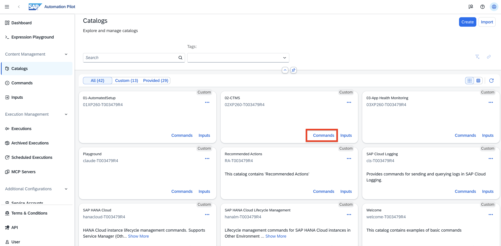

2. Choose **Create**.
<br>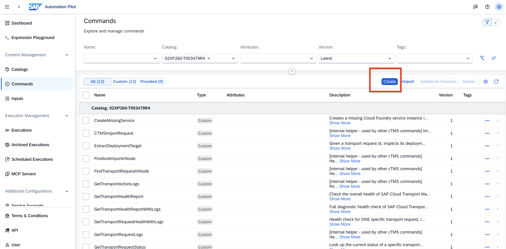

3. Keep the catalog as **02-CTMS**, set the **Name** to **`XP260RetryTransport`**, add a description such as *"Retry transport request command"*, and choose **Create**.
<br>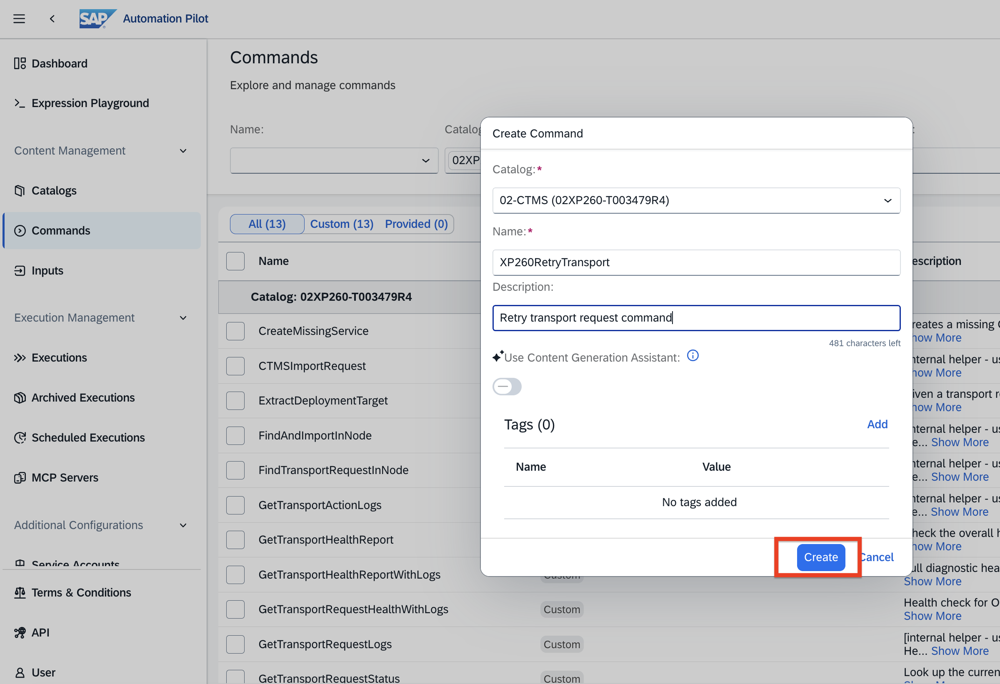

The new command opens with an empty **Contract**. Choose **Add** under **Input Keys**.
<br>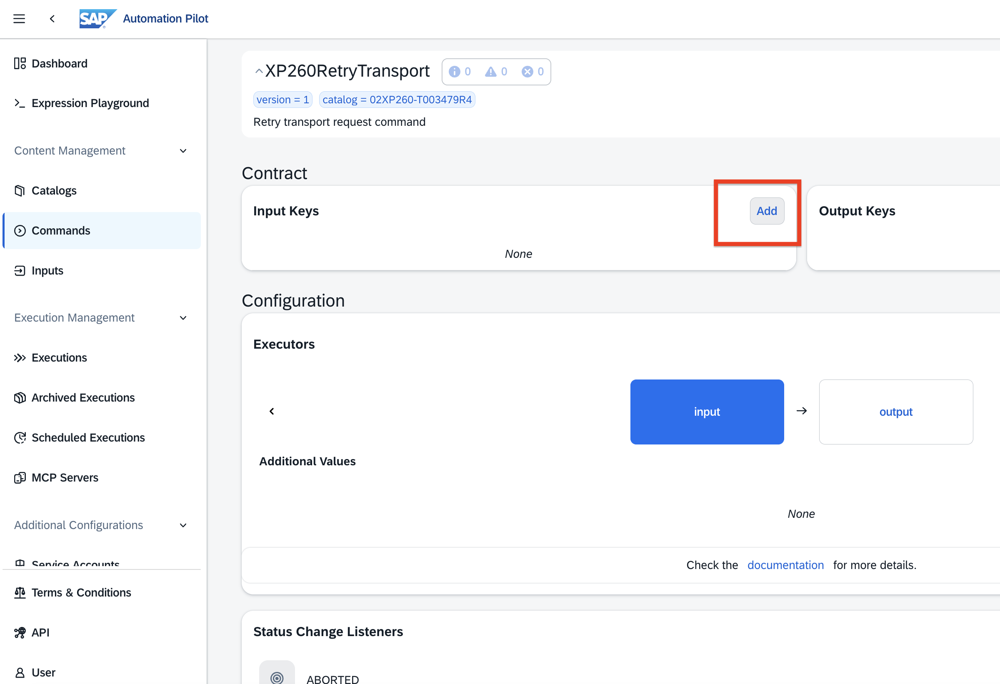

#### Step 2. Add the Input Keys

**`transportRequestIds`** — the ids to re-import. **Name** `transportRequestIds`, **Type: `array`**, **Required** on.
<br>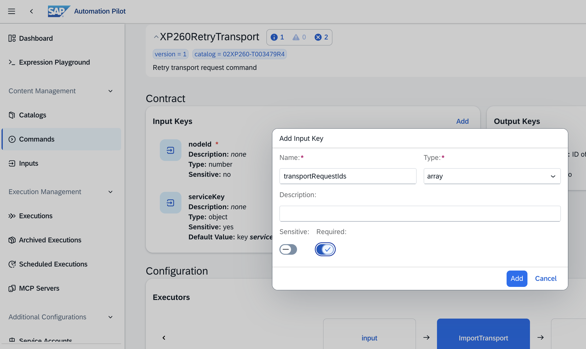

> **Note:** `transportRequestIds` is an **array**, because the cTMS executor imports a list of ids. When you run the command you will provide it in array form, e.g. `[848]`.

**`nodeId`** — the transport node. **Name** `nodeId`, **Type** `number`, **Required** on.
<br>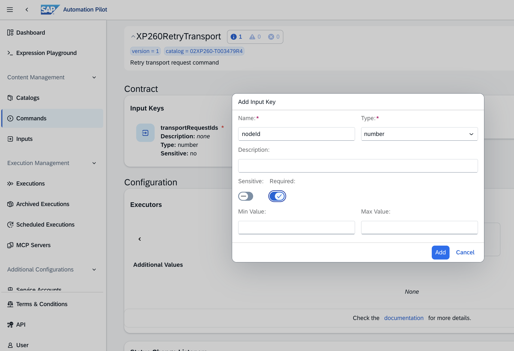

**`serviceKey`** — the cTMS credentials. **Name** `serviceKey`, **Type** `object`, **Sensitive** on, **Default Value Source: Input Key**, and map it tp **Input: `cTMS`**, **Input Key: `serviceKey`**.
<br>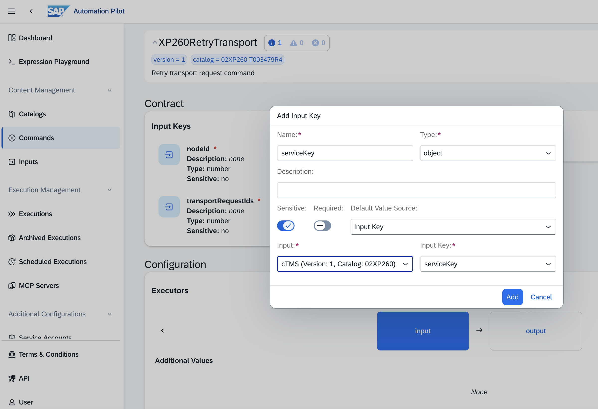

#### Step 3. Add the Output Key

Choose **Add** under **Output Keys**: 
<br>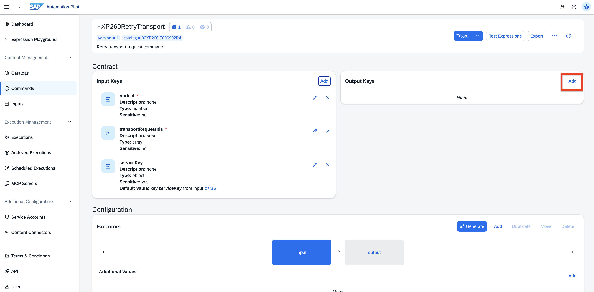 

Then, add **`actionId`** : **Type** `string`, **description** *"ID of the import action created in Cloud Transport Management"*).

<br>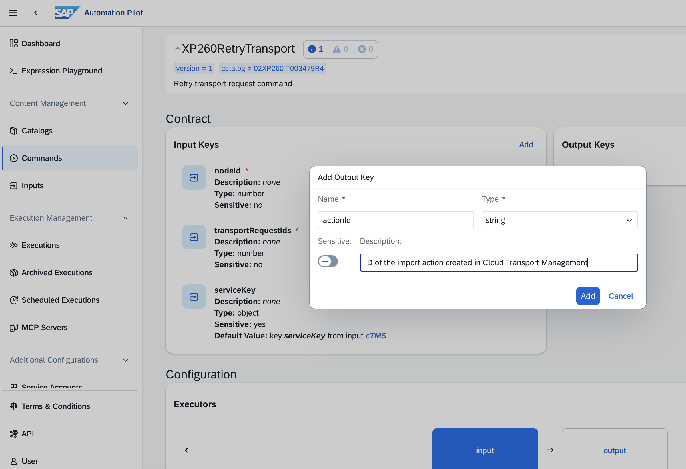

Your Contract now has three input keys and one output key:

<br>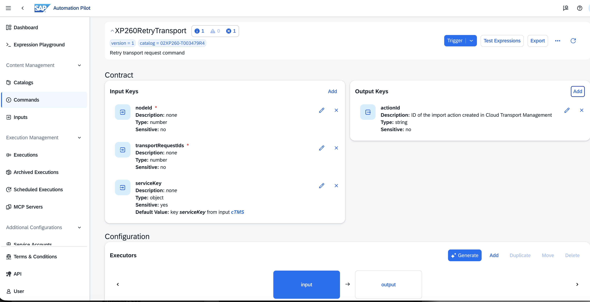

#### Step 4. Add the Executor (with Automap)

1. In **Configuration → Executors**, choose **Add**.

<br>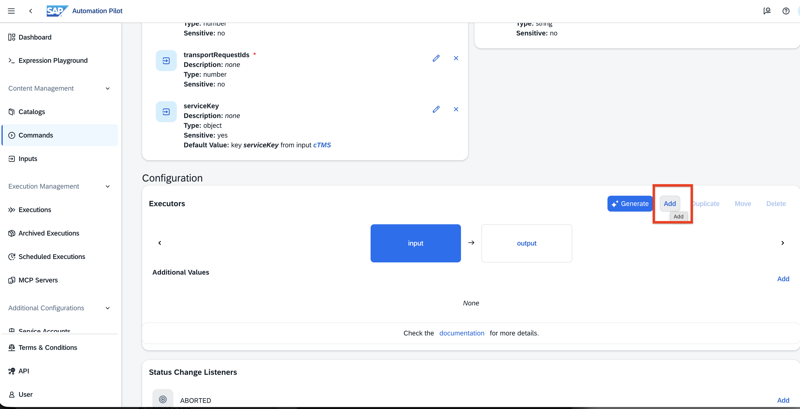

2. In the **Add Executor** dialog set **Executor Location: Here**, **Alias: `ImportTransport`**, **Command: `ImportTransportRequests`** , **Automap parameters: enabled**, and choose **Add**.

<br>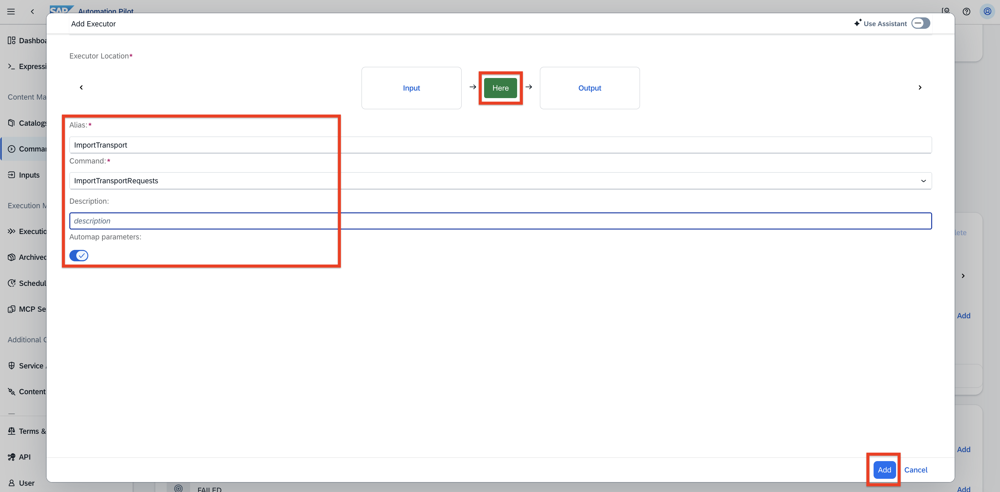 

With Automap on, the executor's parameters are mapped to your input keys automatically — `nodeId`, `serviceKey`, and `transportRequestIds` all resolve to `$(.execution.input.*)` (and `timeout` keeps its default):

<br>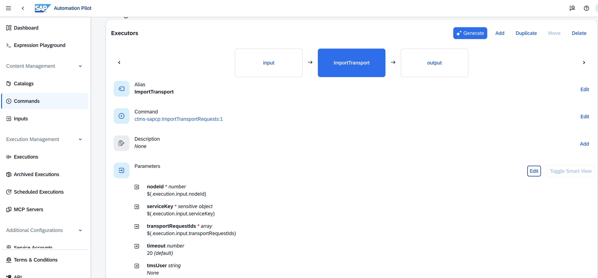

#### Step 5. Map the Output

1. Select the **output** node in the flow and choose **Edit**.

<br>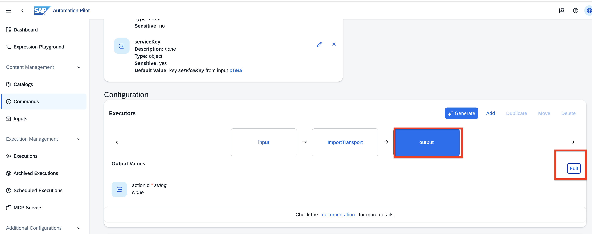

2. Set **actionId** = `$(.ImportTransport.output.actionId)` and choose **Update**.

<br>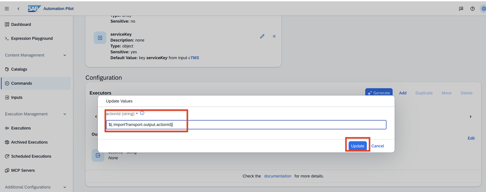

Your command is now complete — inputs, output mapping, and the executor all in place:

<br>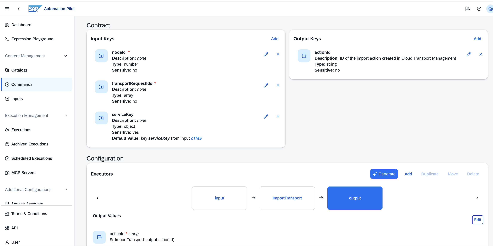

### 4.2.2 - Check the Automations in Place

Now we have the following commands .

#### Command 1: Provision the Missing Destination Service

1. Open your **`XP260CreateDestination`** command (from Exercise 4.1) 


#### Coomand 2: Retrigger the Transport Request

1. Open your **`XP260RetryTransport`**  commad (from Exercise 4.2)

IMPORTAN: You'll use these command in an agentic manner, as an AI Day 2 Operations Agent will be consuming them. This is why you are not triggering them now. 

> **Note:** If you want run the commands later via SAP Automation Pilot to  the issue - **order matters** — provision the Destination service **first**. Retrying the transport before the missing service exists will simply fail again with the same error.

#### Exercise Summary

You built a second command from scratch using only a provided cTMS building block, with a `transportRequestIds` array, a `nodeId`, and an injected service key. You are all set to use the commands with an AI Ops Agent to provisioning the missing service, reading the failed transport's ids from the stored alert, and re-importing the transport — and confirmed a successful deployment with a running application.

## Exercise 4.3 - Expose the Automation through MCP

**Learning Objective**: Understand what the Model Context Protocol (MCP) is, how SAP Automation Pilot exposes commands as MCP tools, and build your own MCP server that publishes the two commands you created — ready for a Joule AI agent to discover and invoke in Exercise 6.

### What is MCP?

The **Model Context Protocol (MCP)** is an open standard that lets AI agents (such as Joule) discover and call external capabilities in a consistent way. If REST APIs are how applications talk to each other, **MCP is how AI agents talk to tools**. Instead of hard-coding integrations, an agent connects to an **MCP server**, reads the list of **tools** it offers, and calls them with natural-language reasoning.

### MCP Servers in SAP Automation Pilot

SAP Automation Pilot can publish your governed commands as **MCP tools** through an **MCP server definition**. This means an AI agent never calls Cloud Foundry, cTMS, or BTP APIs directly — it calls *your* curated, tested commands, with credentials injected by Automation Pilot. The agent gets capability; you keep governance and control.

An MCP server definition has these top-level properties:

| Property | Purpose |
|----------|---------|
| **name** | A unique identifier for the server (e.g. `sample-mcp-server`). |
| **enabled** | Whether the server (and its tools) are active. |
| **instructions** | Natural-language guidance telling the agent what this server does and when/how to use its tools — effectively a short *runbook*. |
| **tools** | The list of commands exposed as callable tools. |

Each **tool** maps one Automation Pilot command to an agent-callable capability:

| Tool field | Purpose |
|------------|---------|
| **Command** | The command to expose, e.g. `<XP260CreateDestination`. |
| **Name** | Snake_case name the agent sees, e.g. `create_destination` (max 32 characters). |
| **Title** | Human-readable Title Case label, e.g. `Create Destination`. |
| **Status Enabled** | Whether this individual tool is active. |
| **Input References** | Stored inputs injected at run time (credentials, environment) so the agent never supplies secrets. |
| **Read-Only** | `enabled` for read-only tools; `false` for tools that change state. |
| **Destructivet** | `enabled` only for tools that delete or irreversibly change state. |
| **Idempotent** | `enabled` for write tools that are safe to repeat. |


### Good Practices for MCP Servers

> [!IMPORTANT]
> A well-designed MCP server is as much about the **instructions and hints** as the tools themselves — they are what let the agent choose and use tools correctly.

- **Expose only agent-facing commands.** Keep internal helper commands out of the server; publish the ones an agent would actually call.
- **Write instructions as a runbook.** Describe the purpose, when to use each tool, and the typical order (e.g. *"create the missing service first, then retry the transport, then verify"*).
- **Set the safety hints honestly.** Mark reads as `Read-Only: enabled`; mark state-changing tools (like retrying a transport) as `Read-Only: disabled`. This helps the agent reason about what is safe to do autonomously.
- **Inject credentials, never request them.** Use `inputReferences` so the agent never has to ask the user for service keys, credentials, org, space, or region.
- **Use clear, concise tool names and titles.** `create_destination` / `retry_transport` are easier for the agent to choose than vague names. Keep tool `name` within 32 characters.

### Build Your MCP Server

#### Step 1. Open MCP Servers

In **SAP Automation Pilot**, open **MCP Servers** (left sidebar menu).

<br>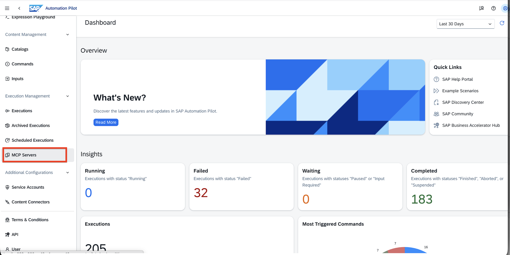

You will see the existing MCP servers. 

<br>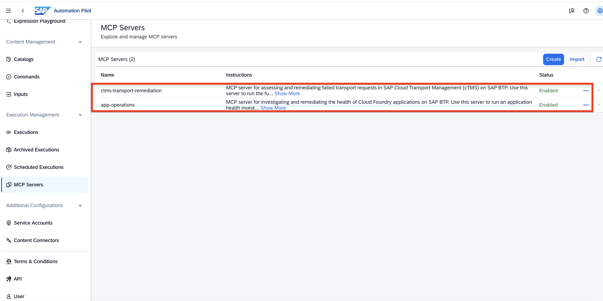

Choose **Create**.
<br>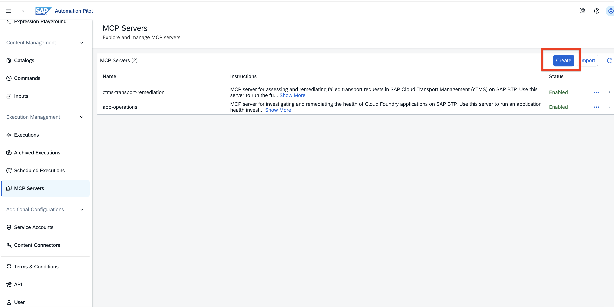

#### Step 2. Create the Server with Instructions

In the **Create MCP Server** dialog:

1. Set the **Name** to **`sampleMcpServer`**.
2. In **Instructions**, write a short runbook that tells the agent what the server does and the order to use its tools, for example:

```
MCP server for remediating failed SAP Cloud Transport Management deployments.
Use it to fix a transport that failed because a required Destination service is missing:
1. Call create_destination to provision the missing Destination service instance.
2. Call retry_transport with the transport request id and node id to re-import the transport.
Credentials and target environment are injected automatically — never ask the user for them.
```

3. Choose **Create**.

<br>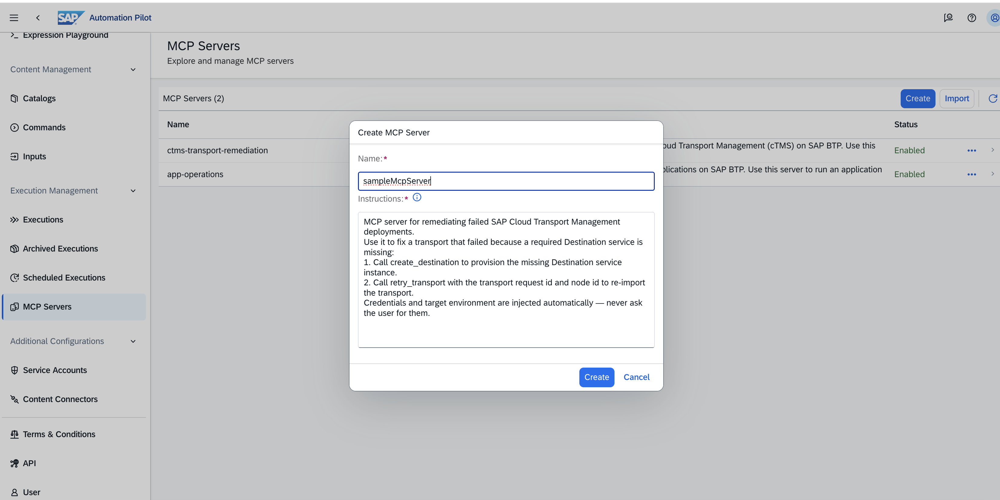

The server is created and **Enabled**, with an **MCP Endpoint** and an empty **Tools** list. Choose **Add** to add the first tool.

<br>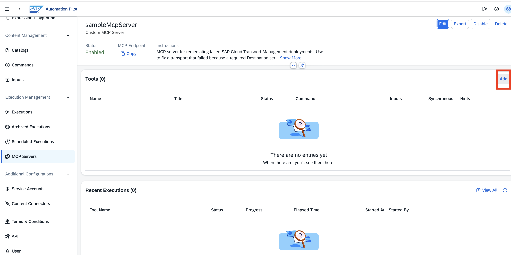

#### Step 3. Add the First Tool — Create Destination

In the **Add New Tool** dialog, expose your `XP260CreateDestination` command:

| Setting | Value |
|---------|-------|
| Name | `createdDest` |
| Title | `createMissingDestination` |
| Command | `XP260CreateDestination` |
| Inputs | `targetEnvironment`, `techUser` |
| Synchronous | off |
| Read-Only / Destructive / Idempotent | all off |

Then choose **Add**.

<br>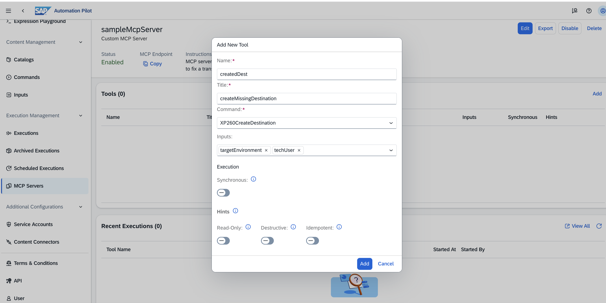

> **Note:** The **Inputs** you select here are the stored inputs that get injected automatically — so the agent never has to supply credentials or environment details. `createdDest` *creates* a service, so it is not read-only, but it is not destructive either (it deletes nothing).

#### Step 4. Add the Second Tool — Retry Transport

Choose **Add** again and expose your `XP260RetryTransport` command the same way:

| Setting | Value |
|---------|-------|
| Name | `retryTransport` |
| Title | `retryTransportRequest` |
| Command | `XP260RetryTransport` |
| Inputs | `cTMS` |
| Synchronous | off |
| Read-Only / Destructive / Idempotent | all off |

Your server now exposes **two tools**, both Enabled:

<br>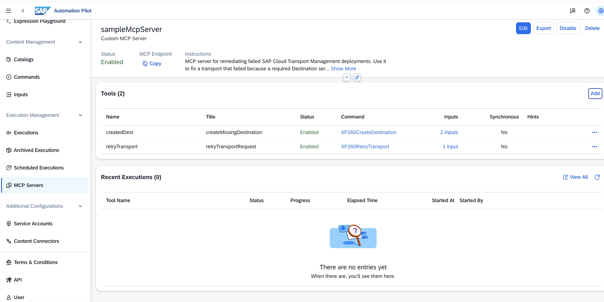

#### Step 5. Get the MCP Endpoint

The **MCP Endpoint** (top of the server page, next to **Copy**) is the URL an MCP client — such as a Joule agent — connects to in order to discover and call your tools.

<br>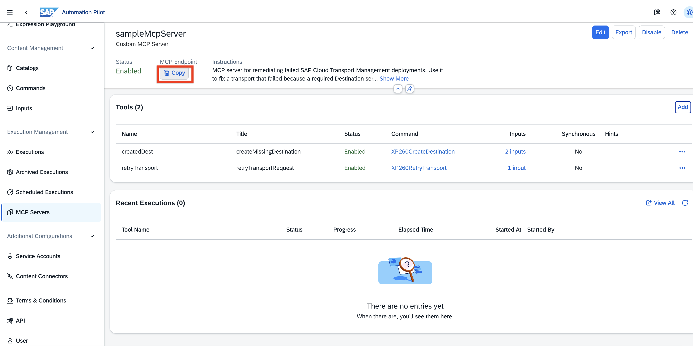

> **Hint:** You will not call this endpoint by hand here — in **Exercise 6**, a pre-configured Joule agent is already connected to MCP servers like this one and will invoke `createdDest` and `retryTransport` on your behalf through natural-language prompts.

#### Exercise Summary

You published your two commands as MCP tools on an MCP server, with runbook-style instructions, injected credentials, and honest safety hints. This is the standardised interface through which a Joule AI agent discovers and executes your governed automations — the bridge from Automation Pilot commands to AI-assisted operations in Exercise 6.

## (Optional) Exercise 4.4 - Retrieve Application Logs from SAP Cloud Logging

**Learning Objective**: Run a provided SAP Cloud Logging command to retrieve recent application log entries — the observability side of operations, complementing the remediation commands you built earlier.

So far your commands *change* the landscape (create a service, retry a transport). This one *observes* it: it reads recent logs for your application from **SAP Cloud Logging**, the observability service that collects your application's output.

> **Deep dive:** This exercise only scratches the surface of SAP Cloud Logging — just enough to retrieve logs through a command. You will explore Cloud Logging in depth, navigating its dashboards and investigating error patterns yourself, in [Exercise 5 - Explore Application Logs with SAP Cloud Logging](../ex5/README.md).

#### Step 1. Open the SAP Cloud Logging Catalog

In **Catalogs**, search for **`cls`** and open the **SAP Cloud Logging** catalog (`cls-...`) — *"Provides commands for sending and querying logs in SAP Cloud Logging."* Choose **Commands**.

<br>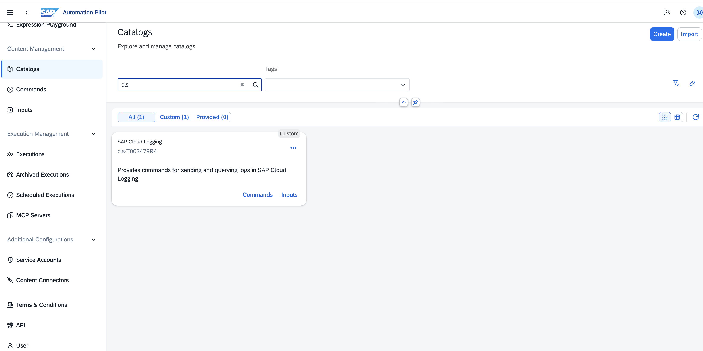

#### Step 2. Open the GetLogs Command

In the catalog's commands, open **`GetLogs`** — *"Retrieve log entries from SAP Cloud Logging for a given time range."*

<br>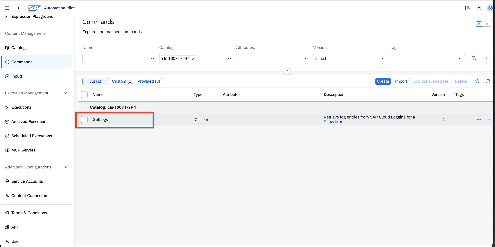

Review its **Contract**: inputs such as `indexPattern` (with suggested values including `logs-cfsyslog-*`), `query`, `from`/`to`, `timeRange`, `size`, and `serviceKey`; outputs `count`, `hits`, and `total`. Then choose **Trigger**.

<br>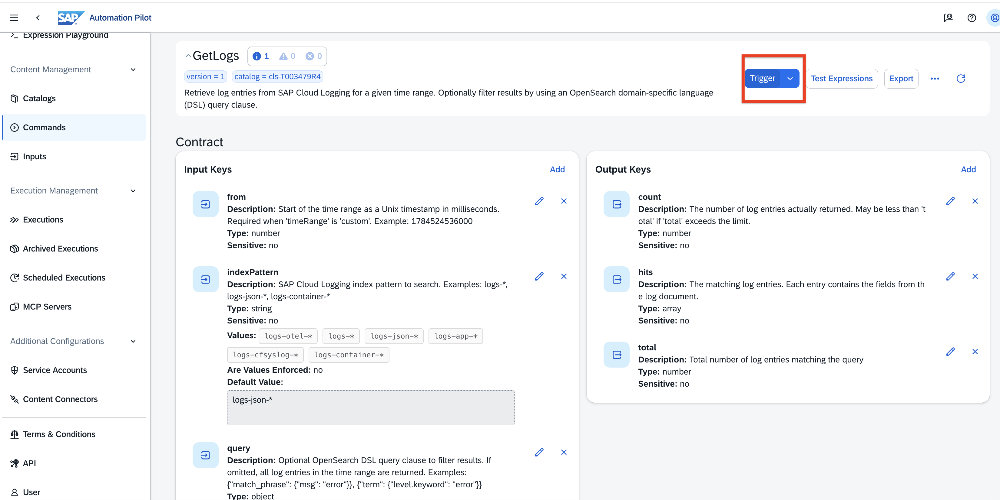

#### Step 3. Select the Cloud Logging Input

In the **Trigger Command** dialog, open the **Inputs** dropdown and select your **`CLS`** input (under the 03-App Health Monitoring catalog). This injects the Cloud Logging service key automatically, so you never paste credentials.

<br>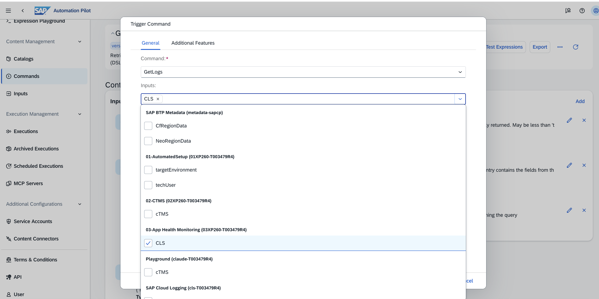

#### Step 4. Set the Index Pattern and Trigger

In **Parameters**, set:

- **indexPattern** = `logs-cfsyslog-*` — the index where your Cloud Foundry application's own log output (stdout/stderr) is stored.
- Leave **query** empty to return all recent entries, **size** at its default (`50`), and **timeRange** at `last 15 minutes`.

The **serviceKey** shows it is taken from your `CLS` input. Choose **Trigger**.

<br>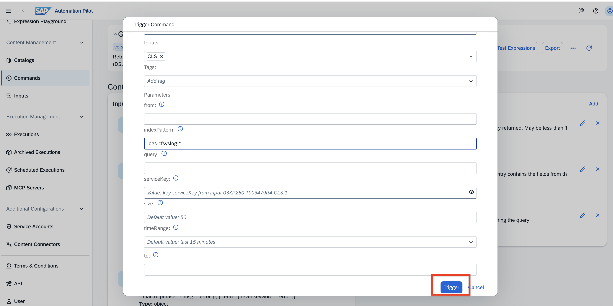

> **Note:** `GetLogs` also accepts an optional **query** input (an OpenSearch DSL clause) to narrow results — for example by application or log level. You can add one once you have seen the log structure in Exercise 5.

#### Step 5. Consume the Output

When the status shows **Finished**, choose **Output → Show**.

<br>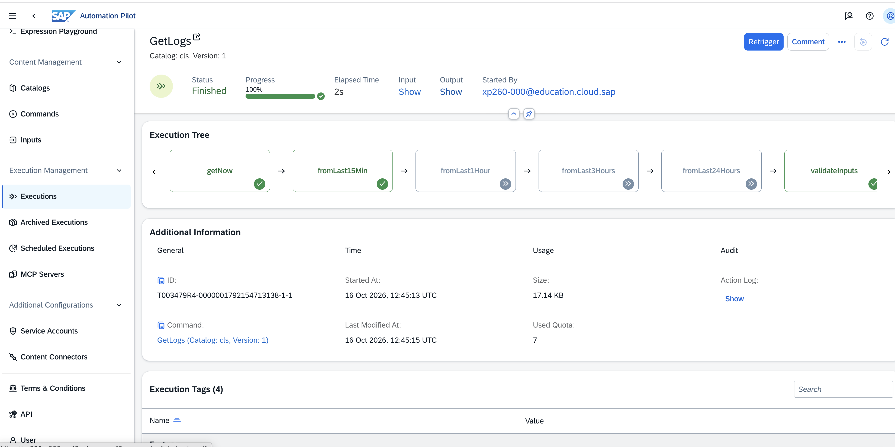

Read the result:

- **total** — total number of log entries matching the query (e.g. `135`).
- **count** — how many were returned (e.g. `50`, the page size).
- **hits** — the matching log entries.

<br>

Expand **hits** to see the raw log documents — note fields like `app_name` (`bookshop-srv`), `source_type` (`APP/PROC/WEB`), `space_name`, and the application messages themselves.

<br>

> **Note:** These are the same log entries you will investigate interactively in Exercise 5, and that a Joule agent reads programmatically in Exercise 6.

### From One Log Command to an Observability Toolset

A single `GetLogs` call is just the start. By varying the **query** and **indexPattern**, you can build a small set of focused log commands — for example "application errors", "memory-status entries", or "requests for a specific app". Exposed together on an **MCP server**, these become an **observability toolset** that any MCP host — a Joule agent, or another AI assistant — can use to investigate application health on demand, exactly as you did here.

#### Exercise Summary

You ran a provided SAP Cloud Logging command, injected the Cloud Logging credentials through the `CLS` input, and consumed its output — the real application log entries. You also saw how a set of such log commands can be published through MCP as reusable observability tools for AI agents, complementing the remediation commands from the earlier parts of this exercise.

## Summary

You have built a r**eusable remediation automation in SAP Automation Pilot** to fix the Destination service dependency and retry a Transport Request Import to confirmed a successful deployment. The automation is now ready to be invoked by a Joule AI agent in Exercise 6.

Continue to - [Exercise 5 - Explore Application Logs with SAP Cloud Logging](../ex5/README.md)
