# Exercise 5 - Explore Application Logs with SAP Cloud Logging

**Human in the Loop: Understanding What You're About to Automate**

The bookshop application is already running in the target subaccount. Before we hand operational tasks to an AI agent, we first learn to investigate application health **manually** using SAP Cloud Logging. Understanding what the logs tell us — seeing the errors and patterns ourselves — is the foundation for building effective automation and for validating what the agent will report later.

**Your Challenge:**
Navigate the pre-built Cloud Foundry dashboards in SAP Cloud Logging, analyze request and application logs, and identify error patterns that indicate potential issues. The findings you make here are exactly the ones the Joule agent will detect programmatically in Exercise 6.

**What You'll Work With:**
- **SAP Cloud Logging** — OpenSearch-based observability service with pre-built CF dashboards
- **CF Overview Dashboard** — high-level KPIs for requests and application logs
- **CF Requests and Logs Dashboard** — detailed log analytics with filtering and correlation

**Why This Matters:**
You do it first, then you automate it. Every automation and every AI-assisted analysis in the next exercises builds on the operational understanding you develop here. If the agent tells you "Book ID 8888 not found" — you will already know what that means because you have seen it yourself.

*Ready to look inside your running application? Let's investigate.*


<details>
<summary>Table of Contents</summary>

- [Exercise 5 - Explore Application Logs with SAP Cloud Logging](#exercise-5---explore-application-logs-with-sap-cloud-logging)
      - [Prerequisites](#prerequisites)
  - [5.1 Open the Bookshop Application](#51-open-the-bookshop-application)
      - [Step 1. Open the Bookshop Application](#step-1-open-the-bookshop-application)
      - [Step 2. Browse the Book Catalog](#step-2-browse-the-book-catalog)
  - [5.2 Navigate to SAP Cloud Logging](#52-navigate-to-sap-cloud-logging)
      - [Step 1. Open Cloud Logging from the BTP Cockpit](#step-1-open-cloud-logging-from-the-btp-cockpit)
      - [Step 2. Explore the SAP Cloud Logging Landing Page](#step-2-explore-the-sap-cloud-logging-landing-page)
      - [Step 3. Explore the CF Overview Dashboard](#step-3-explore-the-cf-overview-dashboard)
      - [Step 4. Review Available Dashboards and Navigate to Requests and Logs](#step-4-review-available-dashboards-and-navigate-to-requests-and-logs)
      - [Exercise Summary](#exercise-summary)
  - [5.3 Investigate Application Errors](#53-investigate-application-errors)
      - [Step 1. Analyze the Requests and Logs Dashboard](#step-1-analyze-the-requests-and-logs-dashboard)
      - [Step 2. Filter for Error Logs](#step-2-filter-for-error-logs)
      - [Exercise Summary](#exercise-summary-1)
  - [5.4 Analyze Memory Status Logs (Optional)](#54-analyze-memory-status-logs-optional)
      - [Step 1. Search for Memory-Related Logs Using DQL](#step-1-search-for-memory-related-logs-using-dql)
      - [Step 2. Edit the Filter to Inspect the Query](#step-2-edit-the-filter-to-inspect-the-query)
      - [Step 3. Switch to OpenSearch Query DSL](#step-3-switch-to-opensearch-query-dsl)
      - [Step 4. Broaden the Filter with a Prefix Query](#step-4-broaden-the-filter-with-a-prefix-query)
      - [Step 5. Review All Memory Status Entries](#step-5-review-all-memory-status-entries)
      - [Exercise Summary](#exercise-summary-2)
  - [Summary](#summary)

</details>

#### Prerequisites

You need access to the **target subaccount** (`XP260_T0XX`) where SAP Cloud Logging is bound to the bookshop application and has been collecting logs. If you need to sign in, follow the login instructions from the [General Section](../ex0/README.md).

---

## 5.1 Open the Bookshop Application

**Learning Objective**: Confirm the bookshop application is running in the target subaccount and trigger backend activity that produces telemetry in SAP Cloud Logging.

<details>
<summary>How to find your Bookshop Application URL via BTP Cockpit</summary>

> [!IMPORTANT]
> Make sure you navigate to your **target** subaccount (`XP260_T0XX`), not the source (`XP260_S0XX`). The bookshop application and SAP Cloud Logging are in the target subaccount.

Your application URL follows the pattern `https://xp260-t0XX-prod-bookshop-srv.cfapps.eu10-005.hana.ondemand.com/` (replace `XX` with your seat number). To find it in the BTP Cockpit:

1. Open the [BTP Cockpit](https://emea.cockpit.btp.cloud.sap/cockpit/?idp=tdct3ched1.accounts.ondemand.com#/globalaccount/b91f4ac2-5fe3-47cc-bcc1-6aa780a0f508/home). On the global account home page, identify your seat number in the greeting ("Hello XP260-0XX!") and click on your **target** subaccount `XP260_T0XX`.

<br>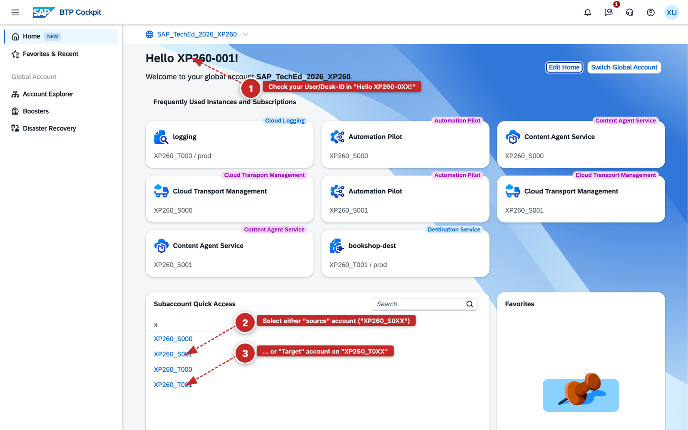

2. In the subaccount, expand **Cloud Foundry** in the left navigation, then click **Spaces**. You will see a single space named **prod** — click on it.

<br>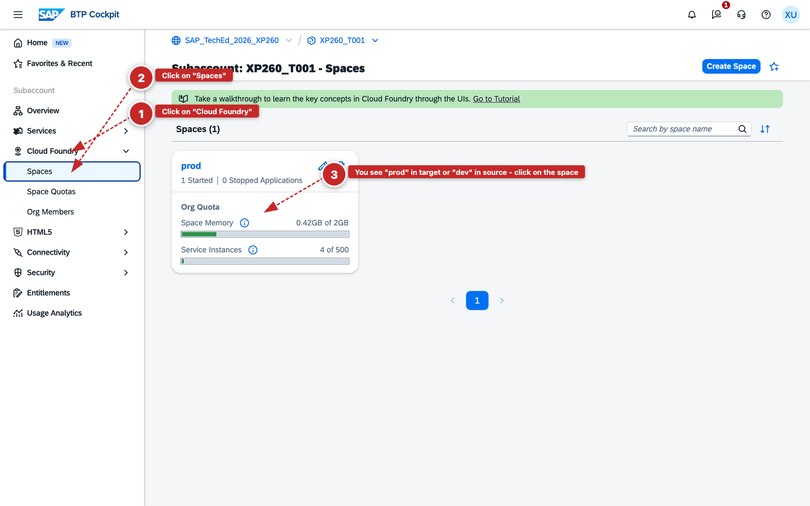

3. In the **Applications** list, click on **bookshop-srv**.

<br>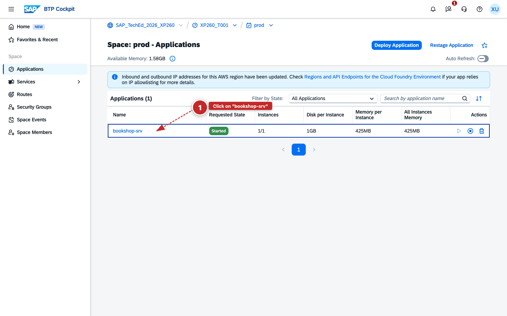

4. On the **Application Overview** page, find the **Mapped Routes** section. The application URL is listed there — click it to open the application in a new tab, or copy it for later use.

<br>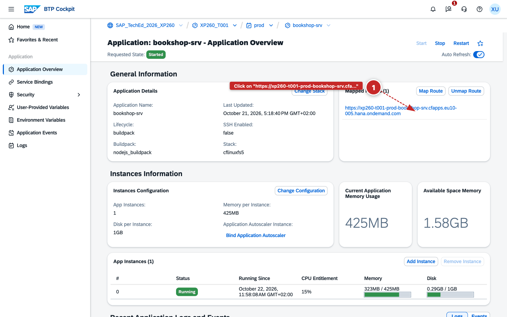

</details>


#### Step 1. Open the Bookshop Application

Open your bookshop application in the **target** subaccount. Your URL follows this pattern (replace `XX` with your seat number):

```
https://xp260-t0XX-prod-bookshop-srv.cfapps.eu10-005.hana.ondemand.com/
```

If you are unsure how to find the URL, expand the section above for step-by-step cockpit navigation.

You will see the **XP260 Bookshop Demo** page with a button to open the application and several API endpoint links.

1. Click **Open Bookshop Application** to enter the admin books view.

<br>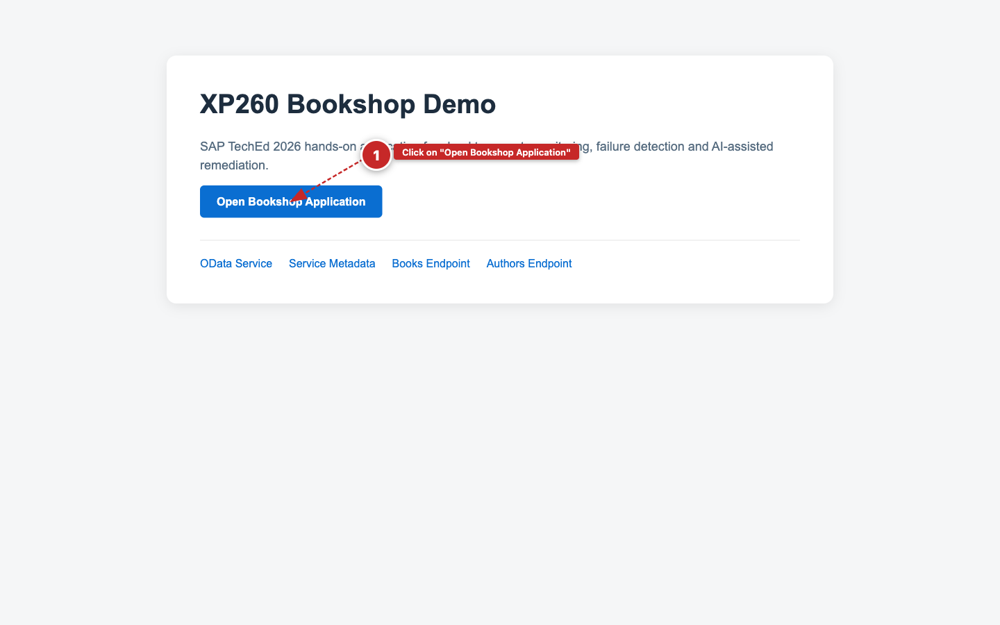

*Bookshop Demo landing page with the application link and API endpoints*


#### Step 2. Browse the Book Catalog

You now see the **Admin Books** view listing 5 books (Wuthering Heights, Jane Eyre, The Raven, Eleonora, Catweazle).

The application appears healthy from here — but behind the scenes, it is generating error-level log entries for book IDs that do not exist in the catalog. These errors are already being collected by SAP Cloud Logging.

<br>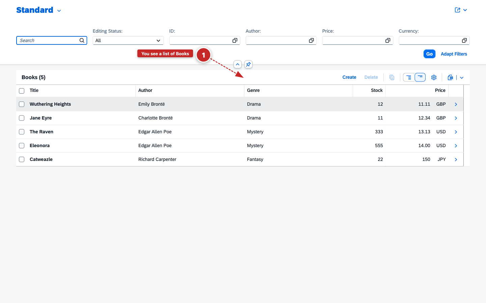

*Admin Books view showing the book catalog — the app looks healthy from here*

---


## 5.2 Navigate to SAP Cloud Logging

**Learning Objective**: Access SAP Cloud Logging from the BTP cockpit and orient yourself in the pre-built Cloud Foundry monitoring dashboards.


#### Step 1. Open Cloud Logging from the BTP Cockpit

Navigate to the **Service Instances** page in your **target** subaccount (`XP260_T0XX`):

1. Open the [BTP Cockpit](https://emea.cockpit.btp.cloud.sap/cockpit/?idp=tdct3ched1.accounts.ondemand.com) and click on your **target** subaccount `XP260_T0XX`.
2. In the left navigation, go to **Cloud Foundry** → **Spaces** → **prod**.
3. Click on **Instances** in the space navigation to see the service instances.
4. In the **Instances** list, find the **logging** entry (Service: Cloud Logging).
5. Click on **logging** in the Instance column to open the SAP Cloud Logging dashboard.

<br>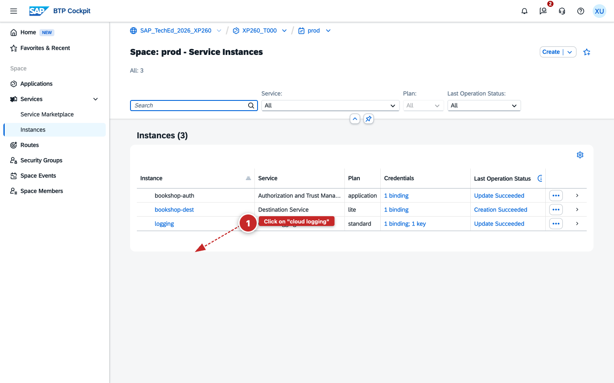

*BTP Cockpit showing the service instances — click on "cloud-logging" to open the dashboard*


#### Step 2. Explore the SAP Cloud Logging Landing Page

You are now on the **"Using your SAP Cloud Logging instance"** landing page.

**What you'll see:**
- An introduction to the service capabilities
- Links to **Cloud Foundry dashboards**, **Kyma dashboards**, **OpenTelemetry**, **Service dashboards**, and **Gen AI dashboards**
- Options to manage alerts, anomaly detection, and saved objects

**Actions to perform:**

1. Read through the capabilities overview (①)
2. Click on **Cloud Foundry dashboards** (②) to navigate to the CF-specific monitoring views

<br>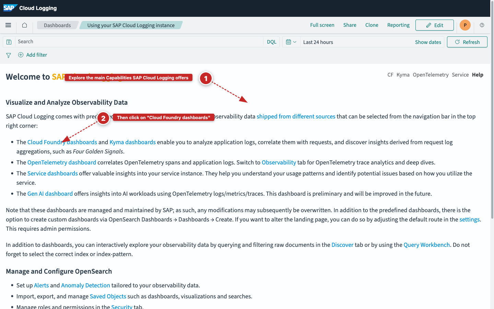

*SAP Cloud Logging landing page — click "Cloud Foundry dashboards" to proceed*


<details>
    <summary>📷💡 Troubleshooting: "Welcome to SAP Cloud Logging" doesn't show up</summary>
    <br>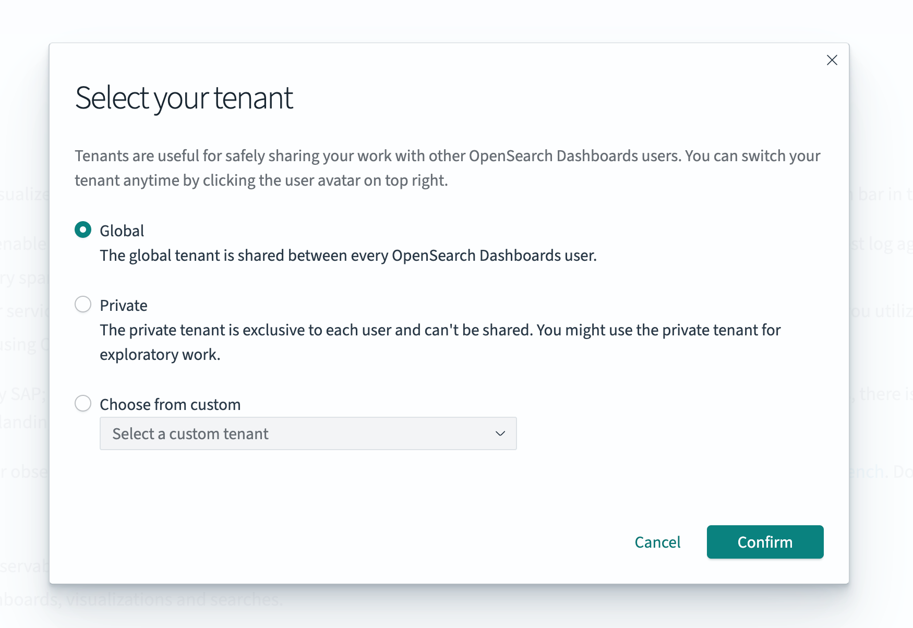

*Select "Global" if a tenant selection dialog show up*


**In Case the "Welcome to SAP Cloud Logging" is not visible**

<br>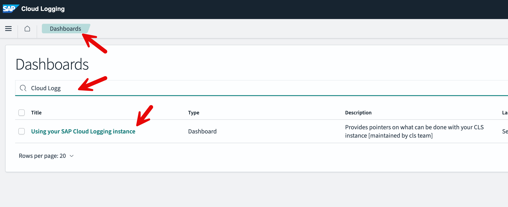

*Navigate to the "Dashboard" section within SAP Cloud Logging and search for the term "Cloud Logging"*

**Navigate directly via deep link:**

Your SAP Cloud Logging URL starts with `dashboards-...` — you can see it in the browser address bar after opening Cloud Logging from the BTP Cockpit in Step 1. Copy everything before `/app/` (this is your instance-specific base URL), then append:
```
/app/dashboards#/view/maintained-by-perfx_using-your-instance-content-package_Using-your-CLS-instance
```

</details>


#### Step 3. Explore the CF Overview Dashboard

You are now on the **CF Overview** dashboard.

<details>
<summary>Direct dashboard link</summary>

Your SAP Cloud Logging URL starts with `dashboards-...` — you can see it in the browser address bar since opening Cloud Logging from the BTP Cockpit in Step 1. Copy everything before `/app/` (your instance-specific base URL), then append:
```
/app/dashboards#/view/maintained-by-perfx_cf-content-package_CF-Overview
```
</details>

**What you'll see:**
- **Requests Overview** on the left: success ratio, P99 response time, average response time, requests per second — all for `bookshop-srv`
- **Application Logs Overview** on the right: log levels (info, error), logs per second, logs per instance
- **Time series charts** showing request and log volume over time

**Actions to perform:**

1. Review the request metrics for `bookshop-srv` — note the success ratio and response times (①)
2. Optionally, expand the time range to **Last 1 hour** using the time picker in the top right (②) to see a broader view of system activity

<br>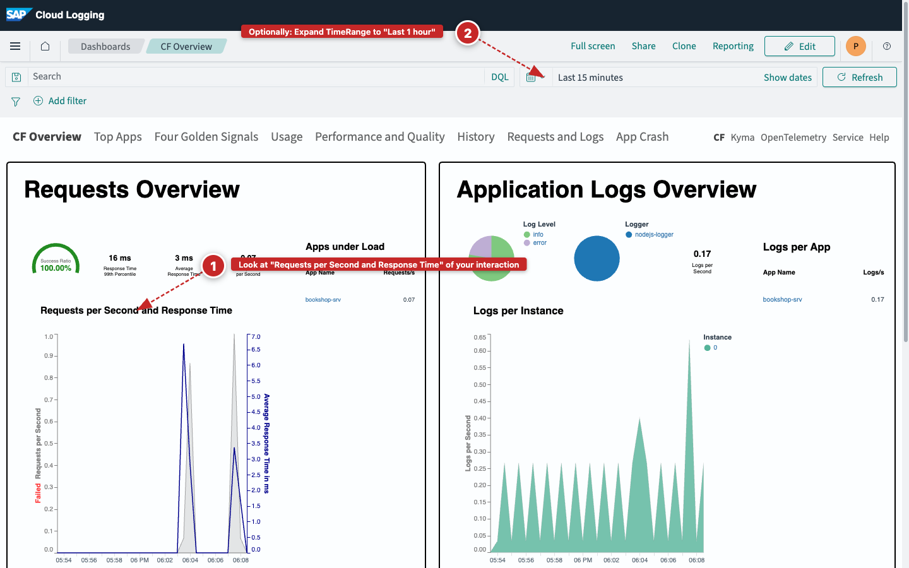

*CF Overview dashboard showing request and log KPIs for bookshop-srv*


#### Step 4. Review Available Dashboards and Navigate to Requests and Logs

With the wider time range, you can now see the full set of Cloud Foundry dashboards in the navigation bar.

**Available dashboards:**
- **CF Overview** — general application request and log overview
- **Top Apps** — key performance indicators per application
- **Four Golden Signals** — latency, traffic, errors, and saturation metrics
- **Usage** — request-based utilization patterns
- **Performance and Quality** — response time analysis
- **History** — historical trends
- **Requests and Logs** — detailed log analytics
- **App Crash Detection** — application failure monitoring

Feel free to explore any of these dashboards. For this exercise, we will focus on **Requests and Logs** to investigate the application errors.

1. Optionally, explore the **Top Apps** (①) and **Four Golden Signals** (②) dashboards to see per-application KPIs and the standard latency/traffic/errors/saturation metrics.
2. Click on **Requests and Logs** (③) in the navigation bar.

<details>
<summary>Direct dashboard link</summary>

Your SAP Cloud Logging URL starts with `dashboards-...` — you can see it in the browser address bar since opening Cloud Logging from the BTP Cockpit in Step 1. Copy everything before `/app/` (your instance-specific base URL), then append:
```
/app/dashboards#/view/maintained-by-perfx_cf-content-package_CF-Requests-and-Logs
```
</details>

<br>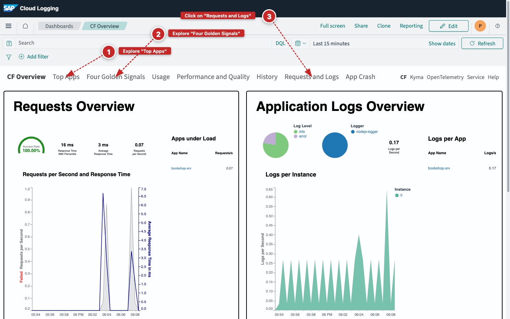

*CF Overview with all navigation tabs visible — click "Requests and Logs"*


#### Exercise Summary

**Result**: You have accessed SAP Cloud Logging from the BTP cockpit and explored the pre-built CF dashboards showing request and log KPIs for your bookshop application.

**Key Capabilities Demonstrated:**
- ✅ **Service discovery**: Finding Cloud Logging in BTP cockpit service instances
- ✅ **Dashboard navigation**: Using the CF dashboard navigation bar
- ✅ **KPI interpretation**: Reading success ratios, response times, and log level distributions

---


## 5.3 Investigate Application Errors

**Learning Objective**: Use the log analytics interface to identify HTTP errors in request logs and filter application logs by error level to discover specific failure patterns.


#### Step 1. Analyze the Requests and Logs Dashboard

The **Requests and Logs** dashboard provides a combined view of three distinct log types:

**What you'll see:**
- **Requests** panel (top): HTTP transactions with trace IDs, response times, and status codes
- **Application Logs** panel (bottom): Business logic and custom application log entries
- **Runtime Logs** panel (below): Platform-level container and deployment information
- **Sidebar panels** (right): **Levels** pie chart showing the ratio of log levels, plus filter panels for organizations, components, and instances

**Actions to perform:**

1. In the **Requests** panel, note the `response_status` column — you will see entries with status **404** alongside successful **200** responses (①)
2. In the **Application Logs** panel, note the mix of `info` and `error` level entries (②)
3. In the **Levels** pie chart on the right, observe the error ratio — approximately **18%** of all application logs are errors (③). Click directly on the **error** slice in the pie chart — this immediately applies a filter to the entire dashboard, showing only error-level logs.

<br>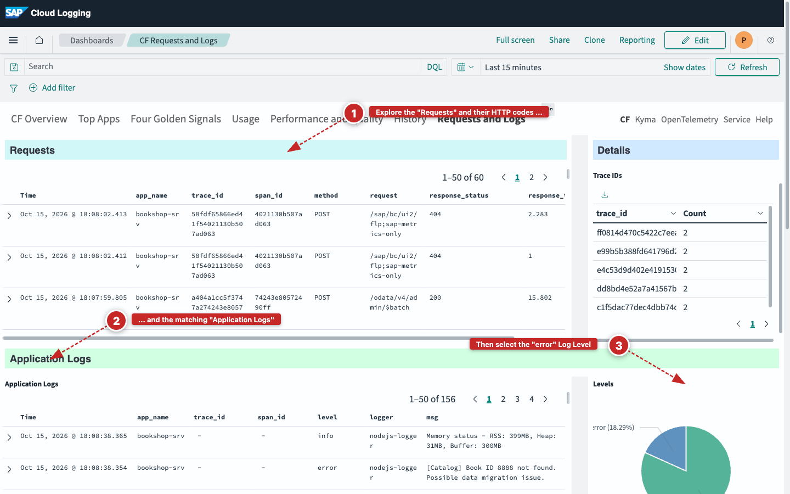

*Requests and Logs dashboard showing HTTP 404 errors in requests and the error ratio in the Levels chart*


#### Step 2. Filter for Error Logs

After selecting the **error** log level, the dashboard filters to show only error-level application logs.

**What you'll see:**
- The **Requests** panel now shows "No results found" — there are no request-level errors matching the filter
- The **Application Logs** panel shows **120 error entries**, all from `bookshop-srv` via the `nodejs-logger`
- The error messages reveal a clear pattern:
  - `[Catalog] Book ID 8888 not found. Possible data migration issue.`
  - `[Catalog] Book ID 9999 not found. Possible data migration issue.`

These are application-level errors: the bookshop service is trying to load books with IDs 8888 and 9999, which do not exist in the catalog database. This could indicate a data migration issue or a misconfigured background process.

To return to the unfiltered view, click the **level.keyword: error** filter pill (②) to remove it.

<br>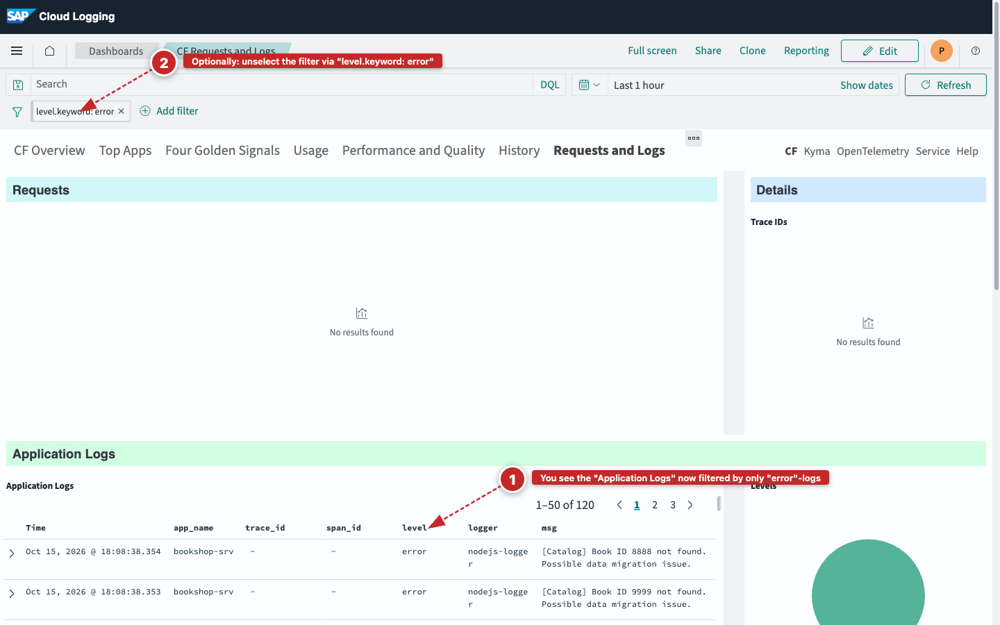

*Application logs filtered by error level — showing the "Book ID not found" pattern*

> [!IMPORTANT]
> Remember these error patterns. In Exercise 6, you will see the Joule agent detect and report exactly these findings — but now you know what they mean because you investigated them yourself.


#### Exercise Summary

**Result**: You identified two types of issues in the bookshop application: HTTP 404 errors in request logs and application-level "Book ID not found" errors indicating potential data migration problems.

**Background**:
SAP Cloud Logging automatically ingests Cloud Foundry syslog data, including HTTP request logs from the CF router and application logs emitted by your code. The pre-built **Requests and Logs** dashboard combines these into a single view with filtering and correlation capabilities, enabling full-stack troubleshooting from HTTP requests through application logic.

**Key Capabilities Demonstrated:**
- ✅ **Multi-tier log analysis**: Simultaneous view of request logs and application logs
- ✅ **Log level filtering**: Isolating error-level entries to focus on problems
- ✅ **Pattern recognition**: Identifying recurring error messages across log entries
- ✅ **Operational readiness**: Building the understanding that powers effective automation

**Further References:**
- [SAP Cloud Logging Documentation](https://help.sap.com/docs/cloud-logging)
- [SAP Cloud Logging — Discovery Center](https://discovery-center.cloud.sap/serviceCatalog/cloud-logging)
- [OpenSearch Dashboard Query Language (DQL)](https://docs.opensearch.org/2.19/dashboards/dql/)

---


## 5.4 Analyze Memory Status Logs (Optional)

> [!NOTE]
> This section is **optional** — work through it if you have time or want to deepen your log analysis skills. It introduces DQL (Dashboards Query Language) for free-text search and shows how to edit filters as raw OpenSearch Query DSL for more powerful matching. These are exactly the kinds of queries the AI agent constructs programmatically in Exercise 6.

**Learning Objective**: Use DQL to search application logs for runtime health data, then refine a filter using OpenSearch Query DSL to match all memory status entries — not just a single log line.

The bookshop application periodically logs its memory consumption (RSS, Heap, Buffer). These entries are not errors, but they are valuable runtime health telemetry. In this section, you will locate and filter for them — first with a simple keyword search, then by crafting a Query DSL filter that matches the full pattern.


#### Step 1. Search for Memory-Related Logs Using DQL

Back on the **Requests and Logs** dashboard (remove any active filters from the previous section), use the **DQL search bar** at the top of the dashboard to search for memory-related log entries.

The search bar uses [Dashboards Query Language (DQL)](https://docs.opensearch.org/2.19/dashboards/dql/) — a simple text-based query language for filtering data in OpenSearch Dashboards. DQL supports free-text search, field-level filtering, and boolean operators.

**Actions to perform:**

1. Type `memory` in the search bar (①)
2. Click **Refresh** (or press Enter) to apply the search (②)
3. In the **Application Logs** panel, observe that the results now show only memory-related log entries (③)

<br>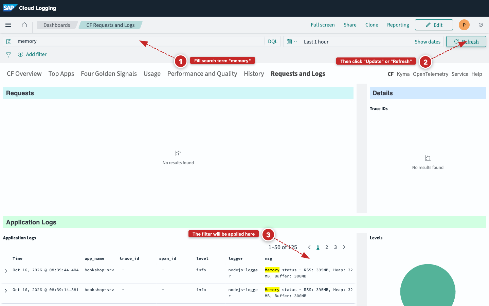

*DQL search for "memory" — the Application Logs panel shows memory status entries*

> [!TIP]
> DQL searches across all text fields by default. You can also target specific fields, for example: `msg: memory` searches only the message field. See the [DQL reference](https://docs.opensearch.org/2.19/dashboards/dql/) for the full syntax.


#### Step 2. Edit the Filter to Inspect the Query

After the DQL search, you can create a precise filter from any log entry. In the **Application Logs** panel, hover over the `msg` column of one of the memory status entries — a small **+** icon ("Filter for value") appears on the right side of the field. Click it to add the exact message as a filter pill below the search bar (e.g., `msg: Memory status - RSS: 395MB, Heap: 32MB, Buffer: 300MB`).

This exact-match filter is too specific — it only matches log entries with those exact memory values. To see **all** memory status log entries regardless of the actual RSS/Heap/Buffer numbers, you need to edit the filter.

**Actions to perform:**

1. Hover over a memory status message in the `msg` column and click the **+** icon to create a filter
2. Click on the resulting filter pill to open the filter actions menu, then click **Edit filter** (①)

<br>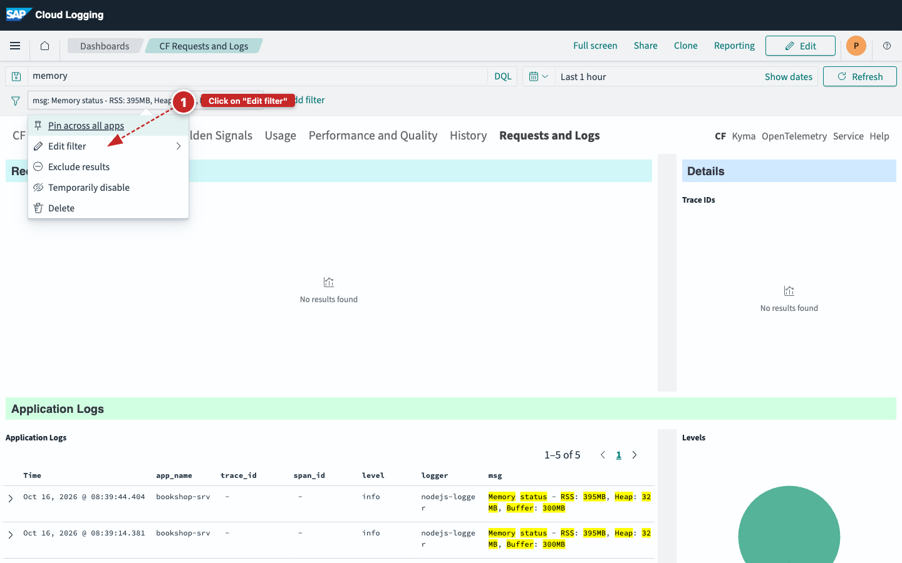

*Filter actions menu — click "Edit filter" to modify the query*


#### Step 3. Switch to OpenSearch Query DSL

The filter editor opens showing the field, operator, and value in a form view. To write a more flexible query, switch to the raw query editor.

**Actions to perform:**

1. Click **Edit as Query DSL** (①) to switch from the form view to the raw OpenSearch Query DSL editor

<br>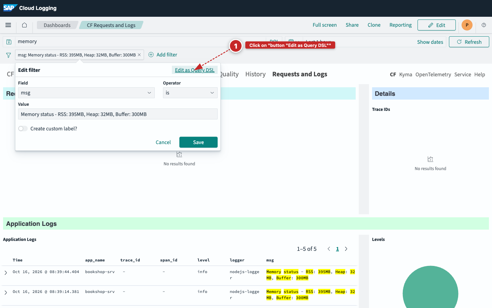

*Filter editor — click "Edit as Query DSL" to access the raw query*


#### Step 4. Broaden the Filter with a Prefix Query

The Query DSL editor now shows the raw OpenSearch query — currently an exact `match_phrase` for one specific memory status line. Replace it with a `match_phrase_prefix` query that matches **all** memory status entries, regardless of the actual memory values.

**Actions to perform:**

1. Replace the existing query with the following `match_phrase_prefix` query (①):

   ```json
   {
     "match_phrase_prefix": {
       "msg": "Memory status - "
     }
   }
   ```

   This matches any log message that **starts with** `"Memory status - "`, capturing all variations of RSS, Heap, and Buffer values.

2. Click **Save** to apply the updated filter (②)

<br>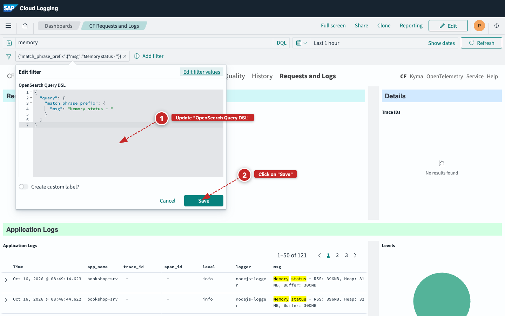

*Query DSL editor — replace the exact match with a match_phrase_prefix query, then save*

> [!TIP]
> `match_phrase_prefix` is one of many OpenSearch query types. It works like `match_phrase` but treats the last term as a prefix, making it ideal for matching log lines that share a common beginning but vary in their details. You can find more query types in the [OpenSearch Query DSL documentation](https://docs.opensearch.org/2.19/query-dsl/).


#### Step 5. Review All Memory Status Entries

The dashboard now shows **all** memory status log entries — every periodic report of the application's RSS, Heap, and Buffer usage, regardless of the specific values.

<br>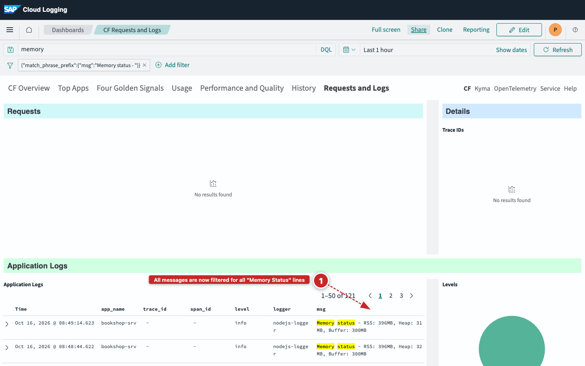

*All memory status entries visible — the prefix query matches every "Memory status - ..." log line*

These periodic memory reports give you a baseline view of the application's runtime health. In Exercise 6, the AI agent will be able to query these same logs programmatically to assess memory trends and detect anomalies.


#### Exercise Summary

**Result**: You used DQL free-text search to locate memory-related logs, then crafted a custom OpenSearch Query DSL filter to match all memory status entries using `match_phrase_prefix`.

**Key Capabilities Demonstrated:**
- ✅ **DQL search**: Using the search bar for free-text filtering across log fields
- ✅ **Filter editing**: Modifying dashboard filters via the filter actions menu
- ✅ **Query DSL**: Writing raw OpenSearch queries for more powerful, flexible matching
- ✅ **Pattern-based filtering**: Using `match_phrase_prefix` to generalize exact-match filters

**Further References:**
- [Dashboards Query Language (DQL)](https://docs.opensearch.org/2.19/dashboards/dql/)
- [OpenSearch Query DSL](https://docs.opensearch.org/2.19/query-dsl/)
- [match_phrase_prefix Query](https://docs.opensearch.org/2.19/query-dsl/full-text/match-phrase-prefix/)

---


## Summary

You have completed a manual investigation of the bookshop application using SAP Cloud Logging. Your key findings:

1. **HTTP 404 request errors** — the CF router logs show requests to endpoints that return 404 status codes
2. **Application-level catalog errors** — the bookshop service repeatedly fails to find Book IDs 8888 and 9999, logging "Possible data migration issue"
3. **Memory status telemetry** (optional) — periodic runtime health reports showing RSS, Heap, and Buffer usage

Along the way, you learned to navigate pre-built CF dashboards, filter by log level, search with DQL, and write OpenSearch Query DSL filters — the same query techniques the AI agent uses programmatically.

You now have the operational understanding to evaluate what the AI agent reports — and to know when it gets it right. Next, we hand these tasks to the Joule agent.

*Continue to — [Exercise 6 - AI Agent for Day 2 Operations](../ex6/README.md)*
