# Exercise 5 - AI Agent for Day 2 Operations with Joule

In this exercise, **you will interact with a Joule AI agent to perform the operational tasks using the commands in SAP Automation Pilot** you created in the previous exercises. Also, the AI agent reasons about the situation and invokes more commands in SAP Automation Pilot (already pre-configured) on your behalf.

A Joule agent has already been created and deployed for each participant in Joule Studio. The agent is connected to two MCP servers that expose the SAP Automation Pilot commands:

**Transport remediation** (MCP server #1, already pre-configured for you) — assess, diagnose, remediate and verify Cloud Transport Management (cTMS) transport requests.
<br>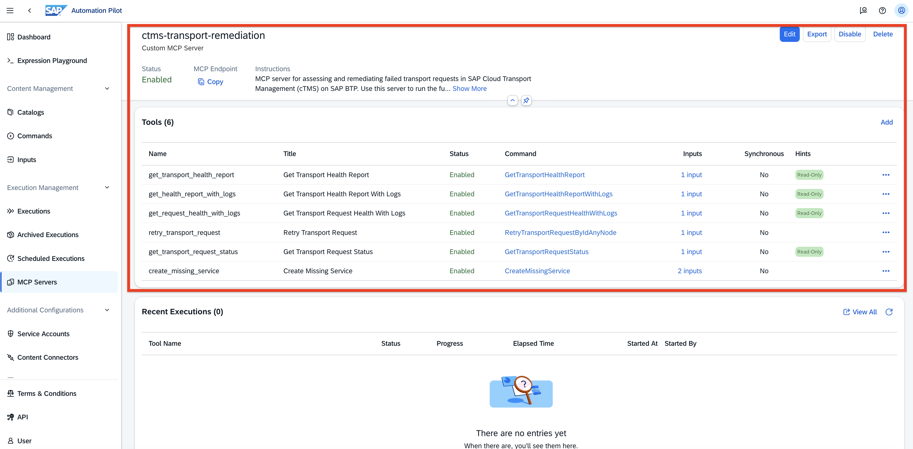

**Application operations** (MCP server #2, already pre-configured for you) — list apps, check memory utilization, analyze logs and memory trends, and scale an application.
<br>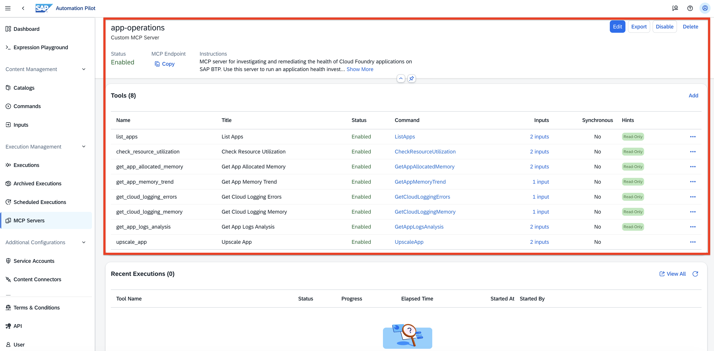

The agent already has the target environment (region, space, organization) and all credentials injected, so **you never need to provide service keys, org, space, or node ids** — you simply describe what you want in natural language.

> **How to work with the agent:** Open your Joule agent and type the prompts shown below. The exact wording does not matter — the agent understands intent, so feel free to rephrase. Where you see a 💬 icon, that is a prompt to type. The screenshots below are **reference interactions**; your transport request ids, node ids and memory figures will differ from the examples.

#### Prerequisites

You need access to your **target subaccount** (`XP260_T0XX`) and your deployed Joule agent. If you need to sign in, follow the login instructions from the [General Section](../ex0/README.md).

#### Open the Agent

Each participant has their **own dedicated Joule agent**, reachable at a personal URL that matches your participant number. For example, participant **XP260-001** opens:

```
https://xp260-000-0d63gfyl.eu10.sapdas.cloud.sap/webclient/standalone/da_xp260u001
```

> **Note:** Use the URL for *your* participant number (shared with you at the start of the session) — it is already wired to your subaccount, MCP servers and credentials.

Open your agent URL. You are greeted with an empty chat and a single message box — everything from here on is natural language.

<br>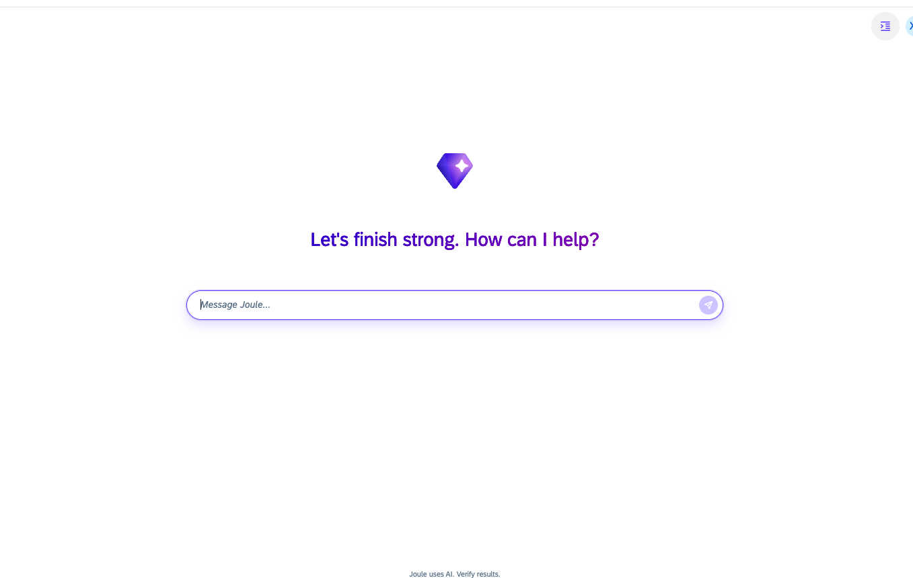

---

## 5.1 Detect and Diagnose the Failure Agentically

**Learning Objective**: Let the agent detect and diagnose the transport failure that results from the missing Destination service you removed in the prerequisites — without navigating Cloud Transport Management yourself.

Instead of opening the cTMS UI, ask the Joule agent to assess your transport landscape and surface any problems.

💬 **Prompt:**
```
Is my transport landscape healthy? Are there any failed transport requests?
```

Behind the scenes, the agent uses the SAP Automation Pilot transport-remediation commands to scan your transport nodes. It returns a **Transport Landscape Health Assessment**: an overall verdict (⚠️ *Unhealthy*), how many nodes were scanned, how many transport requests failed, and a table of the failing requests with their id, status (`Fatal`), node and description.

<br>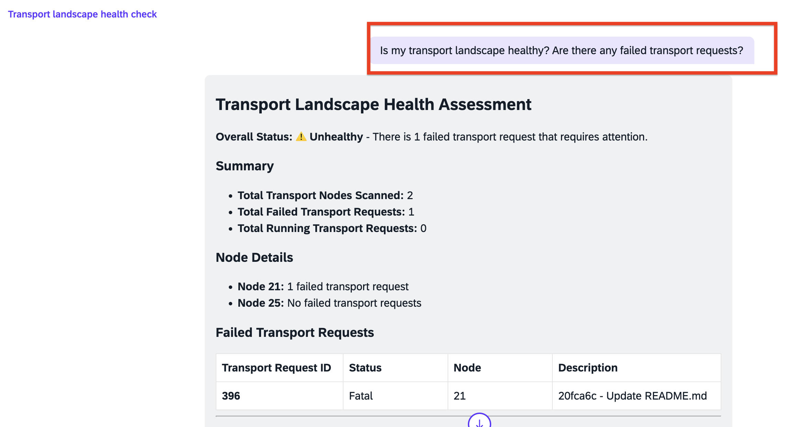

Now drill into the failing request to understand *why* it failed. Use the transport request id the agent just reported.

💬 **Prompt:**
```
Ok, go for it, let's retrieve detailed logs for transport request <id> to identify why it failed.
```

The agent retrieves the transport logs and produces a **Diagnostic Report**: the request's status (⛔ `Fatal`), node, MTA archive, target environment (org and space), and a **Root Cause** section identifying a **Missing Service Instance** — the required Destination service that is absent in the target space, exactly the root cause you investigated manually in the earlier exercises.

<br>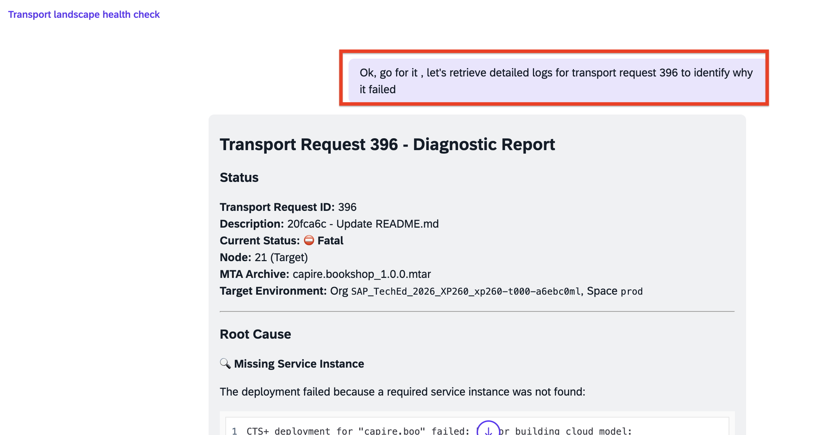

#### Exercise Summary

You asked the agent to assess your transports, and it autonomously discovered the failing transport, read its logs, and diagnosed the missing Destination service as the cause — without you touching the cTMS UI.

---

## 5.2 Let the Agent Remediate the Problem

**Learning Objective**: Have the agent fix the root cause and re-run the transport, demonstrating the shift from manual troubleshooting to AI-assisted, automation-backed remediation.

Because the remediation automation already exists in SAP Automation Pilot, the agent can create the missing service itself.

💬 **Prompt:**
```
Create the missing service for transport request <id>, then retry it and confirm whether it succeeded.
```

The agent will:

1. **Create the missing Destination service** in the correct Cloud Foundry org and space — it reads the target org, space and region from the transport's own logs, so you do not need to supply them.
2. **Retry (re-import)** the transport request by its id.
3. **Verify** the new status and report whether the transport now succeeded.

> **Note:** The agent will only retry *after* the root cause is addressed — retrying before the fix would simply fail again. If it is unsure which service to create, it will ask you to confirm the name.

Ask the agent to confirm the final status of the retried transport. It returns a **Successfully Completed** report with the final status (🎉 *Succeeded*) and a **Summary of Actions Taken** — diagnosed the root cause, created the missing `bookshop-dest` service in the correct org/space, and retried the transport to trigger a fresh deployment.

💬 **Prompt:**
```
ok, check the status of transport request <id>.
```

<br>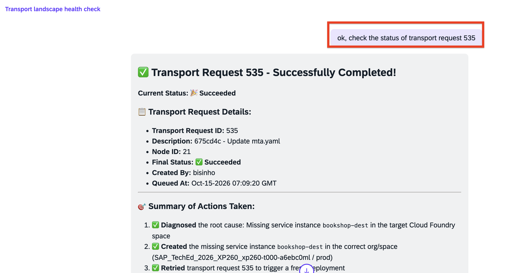

This demonstrates the transition from **manual troubleshooting** to **AI-assisted, automation-backed remediation**.

#### Exercise Summary

The agent created the missing Destination service, retried the transport, and confirmed success — closing the deployment loop entirely through natural-language interaction.

---

## 5.3 Perform an Application Health Analysis

**Learning Objective**: Ask the agent to investigate the running application's health and produce an evidence-based report, detecting the same memory pattern you observed manually in Exercise 6.

Now shift from the deployment to the running application itself. Start by asking the agent what is running.

💬 **Prompt:**
```
hey Joule! Please list my apps.
```

The agent lists the Cloud Foundry applications in your production space — here a single app, **bookshop-srv** (Status: `STARTED`) — and offers to investigate its health. Follow up and ask for the analysis.

💬 **Prompt:**
```
Can you please do an app health status analysis?
```

Using the SAP Automation Pilot application-operations commands, the agent collects evidence from several sources — application state, organization and space memory utilization, the app's allocated memory, its resident-memory (RSS) trend from SAP Cloud Logging, and recent error and memory-status log entries. It opens with an **Executive Summary** and a **Health Verdict** (⚠️ *Under Memory Pressure — Remediation Recommended*).

<br>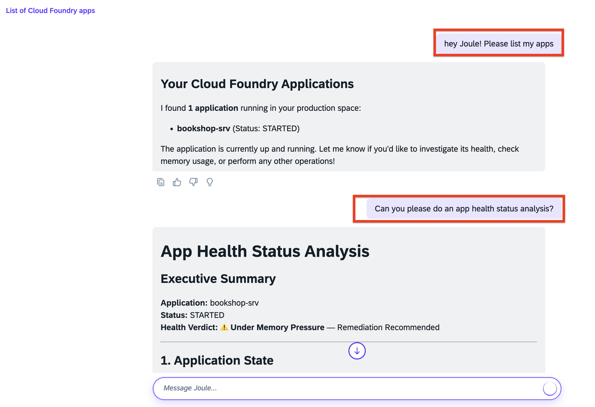

Scroll down to the agent's **Recommendation**. It proposes a concrete, justified action — increase the memory allocation by a specific amount — showing its calculation (current vs. proposed allocation, expected RSS utilization) and confirming the organization has enough free capacity to accommodate it. It also explicitly notes that scaling will **not** fix the application *data* errors.

<br>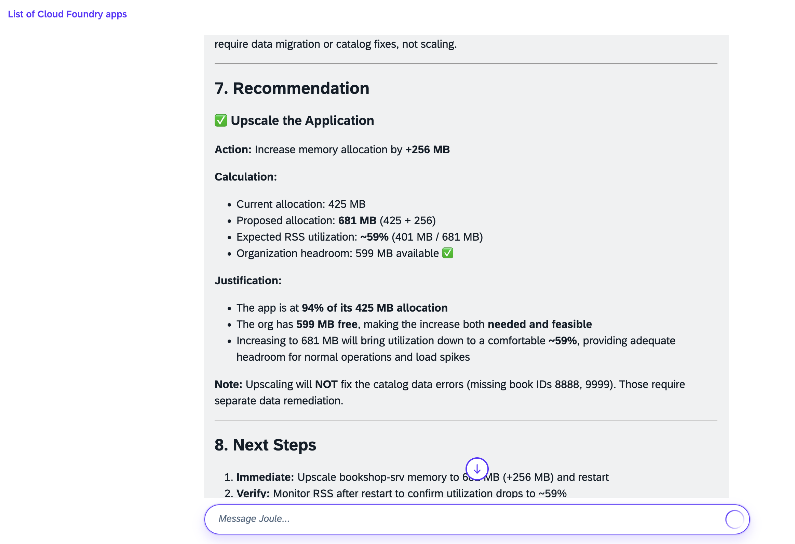

> **Tip — test the agent's judgement.** Ask it to look at the errors directly:
> ```
> ok, can you retrieve logs for the app errors?
> ```
> The agent returns an **Application Error Logs** report: a repeating pattern of **catalog data errors** (missing book IDs `8888` and `9999`), occurring at a steady frequency. A well-reasoned agent distinguishes these application **data** errors from genuine **memory pressure** — and will *not* recommend scaling to fix a data problem.
>
> <br>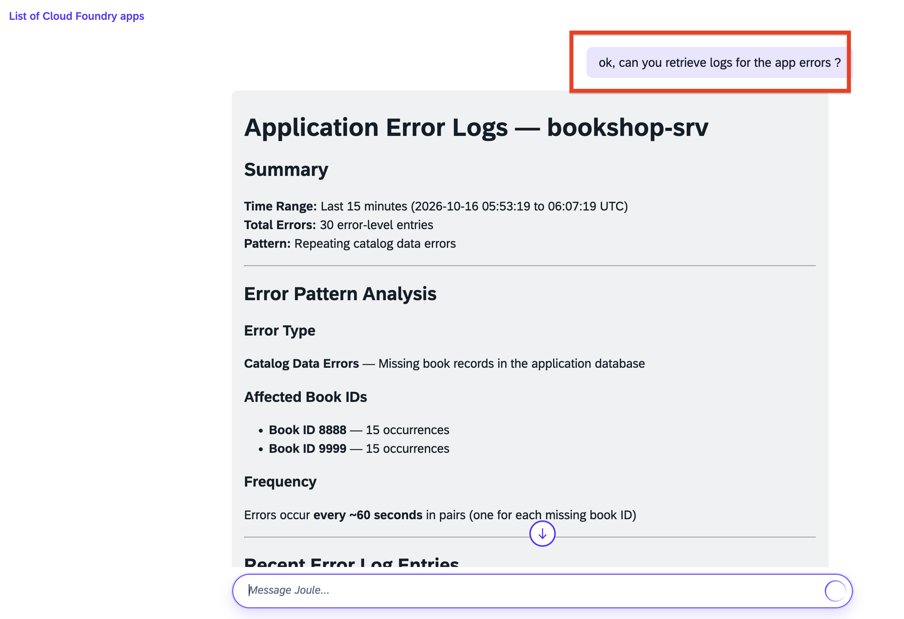

#### Exercise Summary

The agent independently gathered metrics and logs, detected the tight memory allocation, and produced a structured health report with a concrete, justified recommendation — matching the findings you made by hand in Exercise 6. It also correctly separated the data errors from the memory issue.

---

## 5.4 Apply a Recommended Fix

**Learning Objective**: Act on the agent's recommendation and let it scale the application, then confirm the result.

Ask the agent to carry out the fix it recommended — increasing the application's allocated memory to the target it proposed in the previous step.

💬 **Prompt:**
```
OK, let's upscale the app bookshop-srv memory to <target> MB.
```

The agent uses SAP Automation Pilot to increase the application's per-instance memory and restart it so the change takes effect. It returns an **Application Upscaling Complete** report with a before/after table of the memory allocation changes (per-instance memory, total reserved, instances) and the expected memory utilization after the restart.

<br>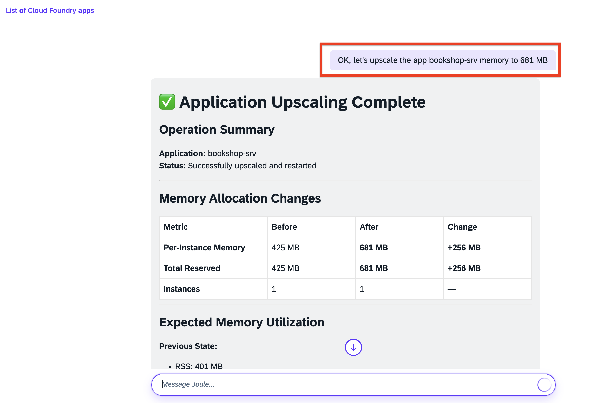

💬 **Optional — verify the result:**
```
Check the application's memory and state again to confirm it recovered.
```

The agent re-runs the health checks and confirms the application is now running with more headroom and a healthier RSS-to-allocation ratio.

#### Exercise Summary

You applied the agent's recommendation through a single natural-language instruction. The agent scaled the application, restarted it, and verified the improved state — completing the remediation.

---

## 5.5 Look Behind the Scenes (Optional)

**Learning Objective**: See that every agent action was a governed SAP Automation Pilot command, invoked through an MCP server — not a black box.

Everything the agent did was backed by the commands you worked with in the earlier exercises, exposed to the agent through two **MCP servers** in SAP Automation Pilot. You can inspect them to see exactly which tools the agent had available and which ones it just ran.

In **SAP Automation Pilot**, open **MCP Servers** (under *Execution Management*).

The **`ctms-transport-remediation`** server exposes the transport tools — *Get Transport Health Report*, *…With Logs*, *Get Transport Request Health With Logs*, *Retry Transport Request*, *Get Transport Request Status*, and *Create Missing Service*. Its **Recent Executions** list shows the very calls your agent made during 5.1 and 5.2 (`get_transport_request_status`, `retry_transport_request`, `create_missing_service`), each run by your Joule service account.

<br>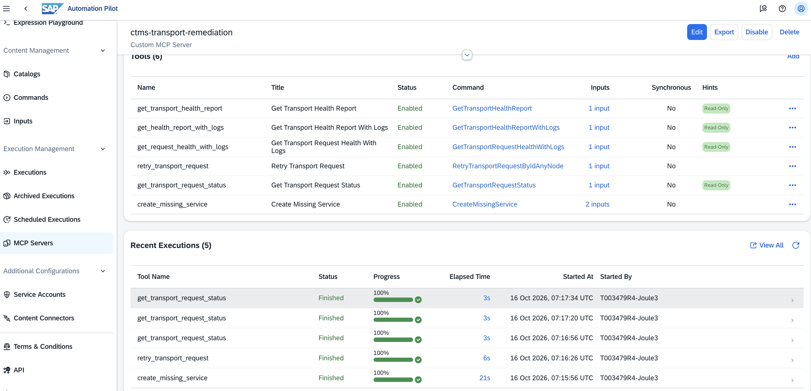

The **`app-operations`** server exposes the application tools — *List Apps*, *Check Resource Utilization*, *Get App Allocated Memory*, *Get App Memory Trend*, *Get Cloud Logging Errors/Memory*, *Get App Logs Analysis*, and *Upscale App*. Its **Recent Executions** list shows the calls behind your 5.3 and 5.4 interactions (`get_app_logs_analysis`, `get_cloud_logging_errors`, `upscale_app`).

<br>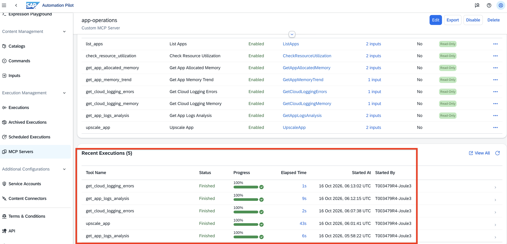

> **Note:** Read-only tools (marked *Read-Only*) only observe; the acting tools (*Create Missing Service*, *Retry Transport Request*, *Upscale App*) are the ones that change your landscape. This is how the agent stays **governed** — it can only do what these published commands allow.

#### Exercise Summary

You confirmed that the agent's behaviour maps one-to-one onto governed SAP Automation Pilot commands, invoked through MCP — the same commands you built and ran by hand in the earlier exercises.

---

## Keep Playing — Prompts to Try

The agent is yours to experiment with. There is no fixed script — try rephrasing, chaining requests, or deliberately testing its reasoning. A few ideas:

**Explore the landscape**
```
Give me a full health report with logs for all my transport nodes.
```
```
What is the current status of transport request <id>?
```

**Dig into the application**
```
What's the memory trend for bookshop-srv over the last 15 minutes?
```
```
How much free memory does my organization have right now?
```
```
Summarise the error patterns in my application logs.
```

**Test its judgement**
```
My app is logging errors — should I scale it up?
```
```
Is it safe to upscale by another 512 MB? Does the org have room?
```

**Chain a full workflow in one go**
```
Check my transports, fix any failures, then do a health check on my app and recommend what to do next.
```

> **Tip:** Watch how the agent asks for confirmation before any action that changes your landscape (creating a service, retrying a transport, scaling the app), and how it refuses or pushes back when a request would not actually help — for example, scaling to "fix" the catalog data errors. That judgement, backed by governed automations, is the point of the exercise.

---

## Summary

You have completed the full Day 2 operations cycle using a Joule AI agent: detected and diagnosed a transport failure, remediated it and confirmed success, performed an application health analysis, and applied a recommended fix — all through agent interaction backed by governed SAP Automation Pilot commands.

Throughout, the agent reasoned about *your* environment, chose the right automations, and kept you in control of the decisions — while handling the credentials, environment details, and command orchestration on your behalf.

**Congratulations! You have successfully completed the full Day 2 operations cycle with a Joule AI agent.**

Continue to - [Exercise 6 - Explore Application Logs with SAP Cloud Logging](../ex6/README.md)
